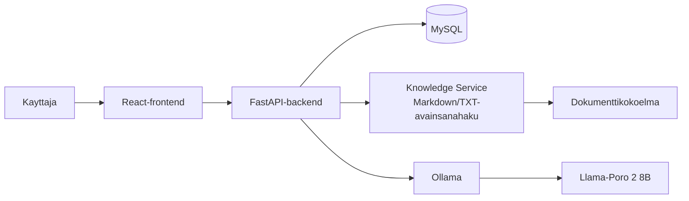
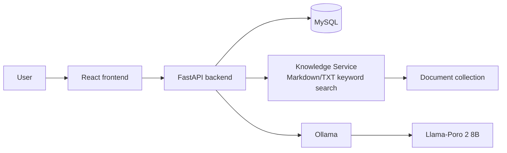

# AI HelpDesk

## Suomeksi

AI HelpDesk on kehitteillä oleva verkkopohjainen tukipalvelusovellus. Käyttäjä voi keskustella tekoälyn kanssa tietotekniikkaan ja ohjelmistokehitykseen liittyvistä ongelmista sekä hallita omia tukipyyntöjään.

> **Projektin tila:** suunnitteludokumentaatio on laadittu. Sovelluksen toteutus, tarkat asennusohjeet ja testikomennot täydennetään koodauksen edetessä.

### Keskeiset ominaisuudet

- Käyttäjätilin luominen, kirjautuminen ja oman profiilin hallinta.
- Tekoälychat ja keskusteluhistoria.
- Tukipyyntöjen luominen, tarkastelu ja sulkeminen.
- Tukipyynnön luominen AI-keskustelusta vasta käyttäjän tarkistuksen ja vahvistuksen jälkeen.
- Etusivun rajattu yhteenveto käyttäjän omista tukipyynnöistä: kokonaismäärä sekä `OPEN`- ja `CLOSED`-määrät.
- Suomen- ja englanninkielinen käyttöliittymä.
- RAG-neuvonta rajatusta Markdown- ja TXT-dokumenttikokoelmasta avainsanahaulla. Semanttista hakua harkitaan vain, jos testit osoittavat avainsanahaun riittämättömäksi.
- Kehitys- ja esittely-ympäristön käynnistäminen Docker Composella, mukaan lukien Ollama ja valittu tekoälymalli.

### Suunniteltu teknologiapino

- Frontend: React (suunniteltu)
- Backend: Python ja FastAPI (suunniteltu)
- Tietokanta: MySQL
- Tekoälypalvelu: Ollama Docker Compose -ympäristössä
- Tekoälymalli: `Llama-Poro-2-8B-Instruct.Q4_K_M.gguf`
- Kontitus: Docker Compose

Työkalujen ja kirjastojen tulee olla maksuttomia. Niiden sekä tekoälymallin lisenssit ja käyttöehdot tarkistetaan ennen toimitusta.

### Arkkitehtuurin yleiskuva

Frontend käyttää backendin REST-rajapintaa. Backend käsittelee liiketoimintalogiikan ja tietokantayhteyden sekä kutsuu Ollamaa Docker Compose -verkon kautta. RAG-haku käsittelee sovittua Markdown- ja TXT-lähdekokoelmaa avainsanoilla. ER-kaavio ja tietokannan suunniteltu rakenne pidetään ennallaan, ellei toteutuksessa ilmene uutta pysyvää tietotarvetta.



### Projektidokumentaatio

- [Projektinhallinta](docs/00-projektinhallinta.md)
- [Vaatimusmäärittely](docs/01-vaatimusmaarittely.md)
- [Käyttäjätarinat ja hyväksymiskriteerit](<docs/02-k%C3%A4ytt%C3%A4j%C3%A4tarinat%20ja%20hyv%C3%A4ksymiskriteerit.md>)
- [Product Backlog](<docs/03-product%20backlog.md>)
- [Sprint-suunnitelma](<docs/04-sprintin%20suunnitelma.md>)
- [Järjestelmän suunnittelu](<docs/05-j%C3%A4rjestelm%C3%A4n%20suunnittelu.md>)
- [UX/UI-suunnittelu](docs/06-ux-ui-suunnittelu.md)
- [Ollama-mallin Modelfile](agents/Modelfile)

### Edellytykset

Suunniteltu käynnistystapa edellyttää Dockeria ja Docker Composea. Valittu GGUF-mallitiedosto sijaitsee projektin `agents`-hakemistossa. Compose-konfiguraatio, mallin käyttöönotto ja mahdolliset ympäristömuuttujat dokumentoidaan tarkemmin toteutuksen yhteydessä.

### Asennus ja käynnistäminen

Tavoitteena on käynnistää frontend, backend, MySQL ja Ollama yhdellä komennolla:

```powershell
docker compose up --build
```

Komennon toimivuus, palveluiden asetukset ja tarvittavat ympäristömuuttujat vahvistetaan, kun Docker Compose -toteutus valmistuu. Älä käsittele tätä ohjetta vielä valmiiksi testattuna asennusohjeena.

### Testaus

Keskeisten toimintojen hyväksymiskriteerit ja suunnitellut testit on kuvattu käyttäjätarinoissa ja vaatimusmäärittelyssä. Testien suorituskomennot lisätään tähän, kun sovelluksen testityökalut ja koodirakenne on toteutettu.

### Kuvat

Sovelluksen käyttöliittymän kuvakaappaukset lisätään toteutuksen valmistuttua. Arkkitehtuuri- ja käyttöliittymäsuunnitelmat löytyvät [järjestelmän suunnittelusta](<docs/05-j%C3%A4rjestelm%C3%A4n%20suunnittelu.md>) ja [UX/UI-suunnittelusta](docs/06-ux-ui-suunnittelu.md).

### Lisenssi

Projektin lisenssiä ei ole vielä määritelty. Myös kolmannen osapuolen mallien, työkalujen ja kirjastojen lisenssit sekä käyttöehdot tarkistetaan ennen julkaisua.

---

## English

AI HelpDesk is a web-based support application under development. Users can discuss IT and software development issues with an AI assistant and manage their own support tickets.

> **Project status:** the design documentation has been prepared. The application implementation, exact setup instructions, and test commands will be completed as development progresses.

### Main features

- User registration, sign-in, and profile management.
- AI chat and conversation history.
- Creating, viewing, and closing support tickets.
- Creating a ticket from an AI conversation only after the user reviews and confirms the proposed details.
- A limited dashboard for the signed-in user's tickets: total count and `OPEN`/`CLOSED` counts.
- Finnish and English user interface.
- RAG over a selected Markdown and TXT document collection using keyword search. Semantic search will only be considered if tests show that keyword search is insufficient.
- Starting the development and demo environment with Docker Compose, including Ollama and the selected AI model.

### Planned technology stack

- Frontend: React (planned)
- Backend: Python and FastAPI (planned)
- Database: MySQL
- AI service: Ollama in the Docker Compose environment
- AI model: `Llama-Poro-2-8B-Instruct.Q4_K_M.gguf`
- Containerization: Docker Compose

Tools and libraries must be free of charge. Their licenses and terms of use, as well as those of the AI model, will be checked before delivery.

### Architecture overview

The frontend uses the backend REST API. The backend handles application logic and database access, and calls Ollama over the Docker Compose network. RAG searches the agreed Markdown and TXT document collection using keywords. The ER diagram and planned database structure will remain unchanged unless implementation reveals a genuine need for additional persistent data.



### Project documentation

- [Project management](docs/00-projektinhallinta.md)
- [Requirements specification](docs/01-vaatimusmaarittely.md)
- [User stories and acceptance criteria](<docs/02-k%C3%A4ytt%C3%A4j%C3%A4tarinat%20ja%20hyv%C3%A4ksymiskriteerit.md>)
- [Product Backlog](<docs/03-product%20backlog.md>)
- [Sprint plan](<docs/04-sprintin%20suunnitelma.md>)
- [System design](<docs/05-j%C3%A4rjestelm%C3%A4n%20suunnittelu.md>)
- [UX/UI design](docs/06-ux-ui-suunnittelu.md)
- [Ollama model Modelfile](agents/Modelfile)

### Prerequisites

The planned setup requires Docker and Docker Compose. The selected GGUF model file is located in the project's `agents` directory. The Compose configuration, model setup, and any required environment variables will be documented in more detail during implementation.

### Installation and running

The intended command for starting the frontend, backend, MySQL, and Ollama is:

```powershell
docker compose up --build
```

The command, service configuration, and required environment variables will be verified when the Docker Compose implementation is complete. This should not yet be treated as a fully tested setup guide.

### Testing

Acceptance criteria and planned tests for the key features are described in the user stories and requirements specification. Test commands will be added here once the application's test tooling and code structure have been implemented.

### Screenshots

Application screenshots will be added after the interface has been implemented. Architecture and interface design materials are available in the [system design](<docs/05-j%C3%A4rjestelm%C3%A4n%20suunnittelu.md>) and [UX/UI design](docs/06-ux-ui-suunnittelu.md) documents.

### License

The project license has not yet been defined. Licenses and terms of use for third-party models, tools, and libraries will also be checked before release.
