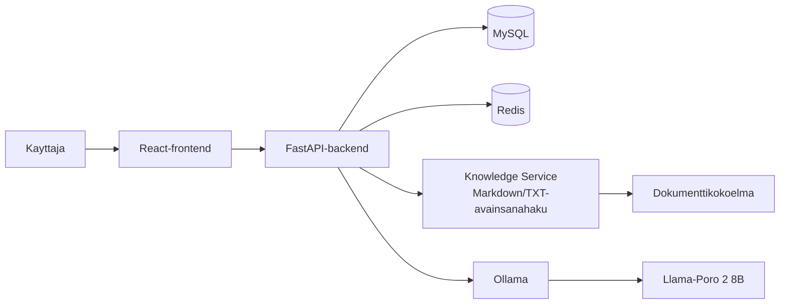
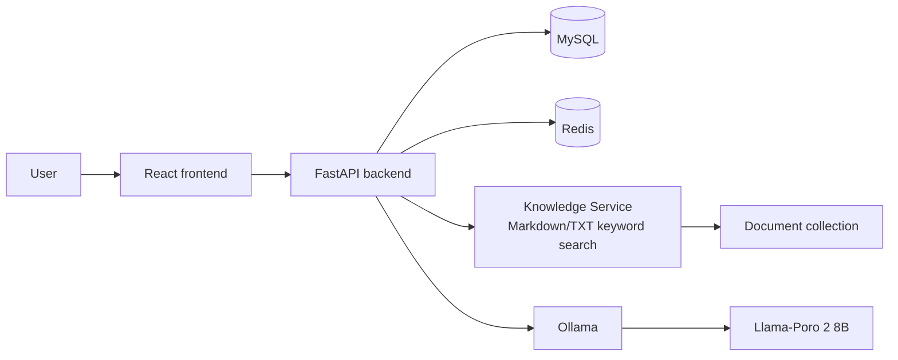

# AI HelpDesk

## Suomeksi

AI HelpDesk on kehitteillä oleva verkkopohjainen tukipalvelusovellus. Käyttäjä voi keskustella tekoälyn kanssa tietotekniikkaan ja ohjelmistokehitykseen liittyvistä ongelmista sekä hallita omia tukipyyntöjään.

> **Projektin tila 05.11.2026:** Projektin toteuttaja on vahvistanut käyttäjätarinoiden US-01–US-17 käytännön hyväksymiskriteerit suoritetuiksi. US-07:n ja US-15:n testauksessa havaittuja tekoälymallin ja RAG:n laatuhavaintoja on kirjattu projektinhallintadokumenttiin. Backendin 86 testistä 85 läpäisi ja yksi valinnainen MySQL-integraatiotesti ohitettiin normaalissa ajossa; erikseen ajettu rekisteröitymisen ja kahdeksan rinnakkaisen kirjautumisen integraatiotesti läpäisi. Frontendin lint, TypeScript-tarkistus ja tuotantobuild onnistuivat. Tarkempi tilanne on [projektinhallintadokumentissa](docs.suomi/docs/00-projektinhallinta.md).

### Keskeiset ominaisuudet

- Käyttäjätilin luominen, kirjautuminen ja uloskirjautuminen; profiilissa etu- ja sukunimi sekä sähköpostiosoite ovat vain luettavia, käyttäjänimi on muokattavissa.
- Ollama-pohjainen tekoälychat, tallennettu keskusteluhistoria ja epäonnistuneen AI-vastauksen erillinen uudelleenyritys.
- Tukipyyntöjen luominen, tarkastelu ja sulkeminen.
- Tukipyyntöjen prioriteetit LOW, MEDIUM ja HIGH erotetaan visuaalisesti toisistaan.
- Etusivun rajattu yhteenveto käyttäjän omista tukipyynnöistä: kokonaismäärä sekä `OPEN`- ja `CLOSED`-määrät.
- Suomen- ja englanninkielinen käyttöliittymä.
- RAG hakee avainsanoilla rajatusta Markdown- ja TXT-dokumenttikokoelmasta ja on integroitu AI-keskusteluun; US-15 on hyväksytty käytännössä, ja hakujen sekä generatiivisten vastausten tunnetut rajoitteet on kirjattu.
- Kehitys- ja esittely-ympäristön käynnistäminen Docker Composella, mukaan lukien Ollama ja valittu tekoälymalli.

### Teknologiapino

- Frontend: React ja TypeScript
- Backend: Python ja FastAPI
- Tietokanta: MySQL
- Kirjautumisen käyttörajoitukset: Redis
- Tekoälypalvelu: Ollama Docker Compose -ympäristössä
- Oletusmalli: `Llama-Poro-2-8B-Instruct.Q4_K_M.gguf`; käyttäjä voi valita toisen Ollama-mallin `.env`-asetuksilla.
- Kontitus: Docker Compose

Kolmansien osapuolten lisensseistä ja käyttöehdoista on tehty alustava inventointi ([raportti](docs.suomi/docs/07-kolmansien%20osapuolten%20lisenssiselvitys.md)). Projektin oma lisenssi ja raportissa luetellut jakeluun liittyvät ehdot ovat vielä avoinna.

Ollama-ympäristö testataan projektissa NVIDIA-GPU:lla. Muiden GPU-valmistajien tai -tyyppien yhteensopivuutta ei varmenneta tässä projektissa; niiden käyttöä haluava käyttäjä testaa yhteensopivuuden itse.

### Arkkitehtuurin yleiskuva

Frontend käyttää backendin REST-rajapintaa. Backend käsittelee liiketoimintalogiikan ja tietokantayhteyden sekä kutsuu Ollamaa Docker Compose -verkon kautta. MySQL tallentaa käyttäjät ja palvelinpuolen kirjautumisistunnot. Redis jakaa kirjautumisyritysten käyttörajat backend-pyyntöjen välillä. RAG-haku käsittelee sovittua Markdown- ja TXT-lähdekokoelmaa avainsanoilla.



### Projektidokumentaatio

- [Projektinhallinta](docs.suomi/docs/00-projektinhallinta.md)
- [Vaatimusmäärittely](docs.suomi/docs/01-vaatimusmaarittely.md)
- [Käyttäjätarinat ja hyväksymiskriteerit](<docs.suomi/docs/02-k%C3%A4ytt%C3%A4j%C3%A4tarinat%20ja%20hyv%C3%A4ksymiskriteerit.md>)
- [Product Backlog](<docs.suomi/docs/03-product%20backlog.md>)
- [Sprint-suunnitelma](<docs.suomi/docs/04-sprintin%20suunnitelma.md>)
- [Järjestelmän suunnittelu](<docs.suomi/docs/05-j%C3%A4rjestelm%C3%A4n%20suunnittelu.md>)
- [UX/UI-suunnittelu](docs.suomi/docs/06-ux-ui-suunnittelu.md)
- [Ollama-mallin Modelfile](ollama/Modelfile)

### Edellytykset

Käynnistys edellyttää Dockeria ja Docker Composea. Luo paikallinen `.env` kopioimalla esimerkkitiedosto, aseta tietokantatunnukset ja luo jokaiselle ympäristölle oma `JWT_SECRET_KEY`. PowerShellissä luo 32 satunnaisesta tavusta muodostuva 64-merkkinen avain komennolla `[Convert]::ToHexString([Security.Cryptography.RandomNumberGenerator]::GetBytes(32))` ja kopioi tulos `.env`-tiedoston `JWT_SECRET_KEY`-arvoksi. Älä käytä samaa avainta eri ympäristöissä.

```powershell
if (-not (Test-Path .env)) { Copy-Item .env.example .env }
```

### Asennus ja käynnistäminen

Käynnistä frontend, backend, MySQL, Redis ja Ollama yhdellä komennolla:

```powershell
docker compose up --build
```

Oletusasetuksilla `ollama-model-init` luo mallin `poro-helpdesk` tiedoston `ollama/Modelfile` ja paikallisen GGUF-tiedoston perusteella. Voit valita minkä tahansa käyttötarpeeseesi sopivan Ollama-mallin muuttamalla paikallisessa `.env`-tiedostossa `OLLAMA_MODEL`-arvon ja asettamalla `OLLAMA_MODEL_SOURCE=registry`; alustuspalvelu hakee tällöin mallin Ollama-rekisteristä. Jos haluat käyttää omaa GGUF-mallia, aseta `OLLAMA_MODEL_SOURCE=modelfile`, sijoita GGUF `ollama/models/`-hakemistoon ja päivitä `ollama/Modelfile` käyttämään sitä. Valitse malli, joka tukee Ollaman chat-rajapintaa ja JSON-muotoista ulostuloa. Tarkista mallin laitevaatimukset, viive ja lisenssiehdot sekä kokeile projektin FI/EN- ja RAG-hyväksymiskysymyksiä. Malli tallennetaan pysyvään `ollama_data`-volyymiin; jo olemassa olevaa saman nimistä mallia ei korvata automaattisesti. Mallin vaihtamisen jälkeen tarkista asennus komennolla `docker compose exec ollama ollama list` ja muistissa oleva malli komennolla `docker compose exec ollama ollama ps`.

Esimerkki rekisterimallin valinnasta `.env`-tiedostossa; korvaa mallin nimi Ollama-rekisterissä olevalla mallinimellä:

```dotenv
OLLAMA_MODEL=your-model:tag
OLLAMA_MODEL_SOURCE=registry
```

Paikalliseen HTTP-kehitykseen aseta `.env`-tiedostossa `AUTH_COOKIE_SECURE=false`. Tämä Compose-asetus rajaa frontendin ja backendin `127.0.0.1`-osoitteeseen; sovellus ei tällä asetuksella ole muiden lähiverkon laitteiden käytettävissä. Frontend välittää `/api`-pyynnöt samalle alkuperälle. Compose-ympäristössä frontend käyttää vain erillistä proxy-verkkoa osoitteella `172.30.0.2` ja ottaa backend-yhteyden verkkoaliaksella `backend-proxy`, joten yhteys käyttää sitä verkkorajapintaa, jonka backend tunnistaa luotetuksi. `TRUSTED_PROXY_IPS`-asetuksen oletusarvo rajaa luottamuksen frontendin IP-osoitteeseen. Backend käyttää asiakkaan IP:nä luotetulta proxylta välitetyn ketjun ensimmäistä luottamatonta osoitetta. Jos muutat Compose-verkon tai proxyn osoitetta, päivitä myös `TRUSTED_PROXY_IPS`. Vanhentuneet kirjautumisistunnot siivotaan erillisessä taustatehtävässä tunnin välein, ei kirjautumisen yhteydessä. Nykyistä IP-välitystä ei ole vielä varmennettu kahdella oikealla LAN-laitteella. HTTPS-käyttöönotossa käytä `AUTH_COOKIE_SECURE=true`, aseta `FRONTEND_ORIGINS` sisältämään sovelluksen tarkka HTTPS-alkuperä ja käytä HTTPS:ää tarjoavaa reverse proxyä; määritä myös kyseisen proxyn luottamus erikseen. Aseta `VITE_API_BASE_URL` vain, jos backendin API on eri alkuperässä; arvon tulee olla backendin alkuperäosoite ilman `/api`-polkua.

Jos frontend ajetaan Composen sijasta suoraan Viten kehityspalvelimella (oletusportti 5173), lisää `http://localhost:5173` ja `http://127.0.0.1:5173` `FRONTEND_ORIGINS`-asetukseen. Asetuksen on sisällettävä frontendin tarkka alkuperä, jotta kirjautumisen ulos Origin-tarkistus hyväksyy pyynnön.

Backend ajaa `alembic upgrade head` -migraatiot automaattisesti ennen käynnistymistä. Ensimmäinen baseline-migraatio luo `users`- ja `auth_sessions`-taulut uuteen tietokantaan tai ottaa aiemman käynnistystavan luomat taulut käyttöön niitä muuttamatta. Varmista aiemman version tietokannan skeema ja ota MySQL-volyymista varmuuskopio ennen päivitystä. Alembicin automaattisesti generoima migraatio on ehdotus: tarkista migraatiotiedosto ennen sen yhdistämistä.

LAN-käytössä lisää `FRONTEND_ORIGINS`-asetukseen sovelluksen tarkka alkuperä, esimerkiksi `http://helpdesk.lan:8088`, ja pidä logoutin `Origin`-tarkistus käytössä. Suosi HTTPS:ää ja `AUTH_COOKIE_SECURE=true`-asetusta istuntokeksin suojaamiseksi.

### Sovelluksen käyttö

1. Avaa Compose-käynnistyksen jälkeen `http://localhost:8088` ja luo käyttäjätili tai kirjaudu sisään.
2. Tukipyynnöt-näkymässä voit luoda pyynnön, valita prioriteetin, muokata avointa pyyntöä ja sulkea sen. Suljetun pyynnön tietoja ei voi enää muokata.
3. AI-keskustelu-näkymässä voit luoda keskustelun, lähettää viestejä ja palata aiempiin keskusteluihin. Jos AI-palvelu ei vastaa, jo tallennettu käyttäjän viesti säilyy historiassa; käytä kyseisen viestin **Yritä uudelleen** -toimintoa sen sijaan, että lähettäisit saman viestin uudestaan uutena viestinä.
4. AI-keskustelusta voi luoda tukipyynnön: järjestelmä ehdottaa otsikon ja kuvauksen, käyttäjä voi tarkastaa ja vahvistaa luomisen ennen tallennusta. Peruutus tai hylkäys ei luo pyyntöä.
5. Profiilissa voit vaihtaa käyttäjänimen. Etunimi, sukunimi ja sähköpostiosoite näkyvät vain luettavina tietoina.
6. Vaihda käyttöliittymän kieltä FI/EN-valinnalla. Valinta tallentuu samaan selaimeen.
7. Etusivulla näytetään kirjautuneen käyttäjän omien tukipyyntöjen kokonaismäärä sekä `OPEN`- ja `CLOSED`-määrät.

**Tietojen säilytys:** taustatehtävä suoritetaan päivittäin ja poistaa pysyvästi yli kolme kalenterikuukautta suljettuina olleet tukipyynnöt (`closed_at`) sekä yli kolme kalenterikuukautta käyttämättöminä olleet keskustelut (`updated_at`). Keskustelu säilytetään, jos siihen liittyy avoin tukipyyntö tai tukipyyntö, jonka oma säilytysaika ei ole vielä täyttynyt. Keskustelun viestit poistuvat keskustelun mukana. Poistoa ei voi peruuttaa; ota tarvittavat varmuuskopiot ja noudata organisaation tietojen säilytyskäytäntöjä.

### Ylläpitäjän ohje: unohtuneen salasanan palautus (US-17)

US-17:n salasanan palautus tehdään vain backendin ylläpitokomennolla. Sovelluksessa ei ole julkista salasanan palautusrajapintaa, käyttäjän palautusnäkymää, sähköpostipalautusta tai ADMIN-käyttöliittymää.

**Ennen palautusta**
1. Varmista käyttäjän henkilöllisyys sovelluksen ulkopuolella organisaation käytännön mukaisesti.
2. Varmista, että sinulla on oikeus käyttää suojattua backend-/Docker-ympäristöä. Docker- ja palvelinympäristön käyttöoikeus antaa mahdollisuuden suorittaa ylläpitotoimintoja.
3. Varmista, että backend ja tietokanta ovat käynnissä.

**Palauta salasana**

Suorita projektin juurihakemistossa PowerShellissä seuraava komento ja korvaa sähköpostiosoite kohdekäyttäjän osoitteella:

```powershell
docker compose exec backend python -m app.admin reset-password --email user@example.com
```

Onnistuneessa palautuksessa komento tulostaa uuden väliaikaisen salasanan kerran. Kopioi se heti ja toimita käyttäjälle varmennetun, turvallisen erillisen kanavan kautta. Käyttäjän on kirjauduttava sisään väliaikaisella salasanalla ja vaihdettava se ennen muiden suojattujen toimintojen käyttöä. Salasanan vaihdon jälkeen käyttäjän on kirjauduttava uudelleen uudella salasanalla.

**Tietoturvaohjeet**
- Älä suorita komentoa jaetussa tai tallentavassa terminaalissa. Suojaa terminaalin tuloste ja tyhjennä/poista mahdolliset tallenteet organisaation käytäntöjen mukaisesti.
- Älä kirjoita väliaikaista salasanaa tikettiin, sähköpostiin, chattiin, komentoriviparametriksi, tiedostoon tai lokiin.
- Älä suorita komentoa uudelleen vain siksi, että salasana jäi kopioimatta. Uusi suoritus luo uuden väliaikaisen salasanan ja mitätöi aiemman; suorita palautus uudelleen hallitusti ja toimita viimeisin salasana turvallisesti.
- Jos käyttäjää ei löydy tai tietokantatoiminto epäonnistuu, komento palauttaa virheen eikä tulosta salasanaa. Tarkista backendin ja tietokannan tila; älä yritä muuttaa salasanaa suoraan tietokannasta.
- Palautus mitätöi käyttäjän kaikki olemassa olevat kirjautumisistunnot.
- Komento ei luo ylläpitäjäroolia eikä tarkista sovelluksen käyttäjäroolia: sen käyttöoikeus perustuu suojatun backend-ympäristön käyttöoikeuksiin.

### Testaus

Frontendin tyypitys, tuotantobuild ja lint-tarkistukset voi suorittaa näin:

```powershell
cd frontend
npm run build
npm run lint
```

Backendin koko `unittest`-testisarjan voi ajaa projektin juuresta Dockerilla:

```powershell
docker compose exec backend python -m unittest discover -s tests -v
```

Testit kattavat proxy-IP:n poiminnan, kirjautumisen rate limiting -laskurit ja Redis-virheet, vanhentuneiden istuntojen siivouskyselyn, kolmen kalenterikuukauden tietojen säilytyssäännöt sekä Ticket API:n validoinnin, omistajuusrajauksen ja keskeiset toiminnot. Erillinen valinnainen integraatiotesti `backend/tests/test_auth_mysql_integration.py` testaa rekisteröitymisen ja kahdeksan samanaikaista kirjautumista käynnissä olevaa Compose API:a ja MySQL:ää vasten. Paikallinen testi ei korvaa ympäristökohtaista LAN-välityksen testausta. Frontendin build ja lint ajetaan erikseen frontend-kansiossa.

03.11.2026 tehdyssä tarkistuksessa backendin kaikki 57 `unittest`-testiä läpäisivät, frontendin lint oli puhdas ja TypeScript-tarkistus sekä tuotantobuild onnistuivat. Tuolloin clean Compose -käynnistys ja integraatiotesti olivat vielä tarkistamatta; ne vahvistettiin erikseen 05.11.2026. Todellisen LAN-välityksen tarkistus on edelleen ympäristökohtainen, eikä se kuulu käyttäjätarinoiden hyväksyntään. Ajantasainen projektitilanne on projektinhallintadokumentissa.

Toteuttaja vahvisti 05.11.2026 koko Compose-pinon käynnistyksen tyhjillä MySQL- ja Ollama-volyymeilla sekä kaikkien US-01–US-17-kriteerien käytännön hyväksynnän. Samana päivänä rekisteröitymisen ja kahdeksan rinnakkaisen kirjautumisen integraatiotesti läpäisi paikallisessa Compose/MySQL-ympäristössä. LAN-välitys todellisessa käyttöympäristössä on edelleen erillinen tarkistus. Nämä eivät ole avoimia user story -hyväksyntöjä.

### Kuvat

Arkkitehtuuri- ja käyttöliittymäsuunnitelmat löytyvät [järjestelmän suunnittelusta](<docs.suomi/docs/05-j%C3%A4rjestelm%C3%A4n%20suunnittelu.md>) ja [UX/UI-suunnittelusta](docs.suomi/docs/06-ux-ui-suunnittelu.md). Kuvakaappauksia ei tällä hetkellä ylläpidetä projektissa.

### Lisenssi

Projektin omaa lisenssiä ei ole vielä määritelty. Kolmansien osapuolten lisensseistä ja käyttöehdoista on tehty alustava inventointi: [lisenssiselvitys suomeksi](docs.suomi/docs/07-kolmansien%20osapuolten%20lisenssiselvitys.md) ja [englanniksi](<docs.eng/docs/07-Third-Party%20License%20Review.md>). Ennen jakelua on vielä ratkaistava selvityksessä luetellut avoimet toimet, kuten projektin lisenssi, mallin lähdetiedot ja Redis 7.4:n ehdot.

---

## English

AI HelpDesk is a web-based support application under development. Users can discuss IT and software development issues with an AI assistant and manage their own support tickets.

> **Project status on 05.11.2026:** The project implementer has confirmed practical acceptance for US-01 through US-17. AI model and RAG quality limitations observed while testing US-07 and US-15 are recorded in the project management document. Of 86 backend tests, 85 passed and one opt-in MySQL integration test was skipped in the standard run; the separate registration/eight-concurrent-sign-in integration test passed. Frontend lint, TypeScript checks, and production build passed. See the [project management document](docs.eng/docs/00-Project%20Management.md) for details.

### Main features

- User registration, sign-in, and sign-out; first name, last name, and email are read-only on the profile, while username can be changed.
- Ollama-backed AI chat, saved conversation history, and a separate retry for a failed AI response.
- Creating, viewing, and closing support tickets.
- Support-ticket priorities LOW, MEDIUM, and HIGH are visually distinguished.
- A limited dashboard for the signed-in user's tickets: total count and `OPEN`/`CLOSED` counts.
- Finnish and English user interface.
- RAG keyword search over a selected Markdown and TXT collection is integrated into AI chat and US-15 has passed practical acceptance; known retrieval and generative-answer limitations are documented.
- Starting the development and demo environment with Docker Compose, including Ollama and the selected AI model.

### Technology stack

- Frontend: React and TypeScript
- Backend: Python and FastAPI
- Database: MySQL
- Login rate limiting: Redis
- AI service: Ollama in the Docker Compose environment
- Default model: `Llama-Poro-2-8B-Instruct.Q4_K_M.gguf`; users can select another Ollama model in `.env`.
- Containerization: Docker Compose

An initial third-party license and terms inventory is available in the [English review](<docs.eng/docs/07-Third-Party%20License%20Review.md>). The project's own license and the distribution actions listed in that review remain open.

The Ollama environment is tested on NVIDIA GPUs. Compatibility with GPUs from other vendors or of other types is not verified by this project; users who want to use them are responsible for testing compatibility.

### Architecture overview

The frontend uses the backend REST API. The backend handles application logic and database access, and calls Ollama over the Docker Compose network. MySQL stores users and server-side login sessions. Redis shares login-attempt limits across backend requests. RAG searches the agreed Markdown and TXT document collection using keywords.



### Project documentation

- [Project management](<docs.eng/docs/00-Project%20Management.md>)
- [Requirements specification](<docs.eng/docs/01-Requirement%20Specification.md>)
- [User stories and acceptance criteria](<docs.eng/docs/02-User%20Stories%20and%20Acceptance%20Criteria.md>)
- [Product Backlog](<docs.eng/docs/03-product%20backlog.md>)
- [Sprint plan](<docs.eng/docs/04-Sprint%20Plan.md>)
- [System design](<docs.eng/docs/05-System%20Design.md>)
- [UX/UI design](<docs.eng/docs/06-UX%20and%20UI%20Design.md>)
- [Ollama model Modelfile](ollama/Modelfile)

### Prerequisites

The setup requires Docker and Docker Compose. Create a local `.env` from the example file, set database credentials, and generate a unique `JWT_SECRET_KEY` for each environment. In PowerShell, run `[Convert]::ToHexString([Security.Cryptography.RandomNumberGenerator]::GetBytes(32))` to generate a 64-character key and paste it into `.env`. Do not reuse the key across environments.

```powershell
if (-not (Test-Path .env)) { Copy-Item .env.example .env }
```

### Installation and running

Start the frontend, backend, MySQL, Redis, and Ollama with:

```powershell
docker compose up --build
```

By default, `ollama-model-init` creates `poro-helpdesk` from `ollama/Modelfile` and the local GGUF file. To choose another Ollama model, set `OLLAMA_MODEL` in the local `.env` and set `OLLAMA_MODEL_SOURCE=registry`; the init service pulls that model from the Ollama registry. To use your own GGUF, set `OLLAMA_MODEL_SOURCE=modelfile`, put the GGUF under `ollama/models/`, and update `ollama/Modelfile` to reference it. Choose a model compatible with Ollama chat and JSON-formatted output, check its hardware requirements, latency, and license, and repeat the project's Finnish/English and RAG acceptance questions. The model is stored in the persistent `ollama_data` volume; an existing model with the same name is not replaced automatically. Check installed models with `docker compose exec ollama ollama list` and the loaded model with `docker compose exec ollama ollama ps`.

Example `.env` settings for a registry model; replace the model name with one that exists in the Ollama registry:

```dotenv
OLLAMA_MODEL=your-model:tag
OLLAMA_MODEL_SOURCE=registry
```

For local HTTP development, set `AUTH_COOKIE_SECURE=false` in `.env`. Compose binds the frontend and backend to `127.0.0.1`, so this setup is not accessible from other devices on the LAN. The frontend sends `/api` requests through the same-origin proxy. In Compose, the frontend uses only the dedicated proxy network at `172.30.0.2` and connects to the backend through the `backend-proxy` network alias, ensuring the connection uses the interface trusted by the backend. The default `TRUSTED_PROXY_IPS` value trusts only the frontend IP. The backend uses the first untrusted address in the chain forwarded by a trusted proxy as the client IP. If you change the Compose network or proxy address, update `TRUSTED_PROXY_IPS` as well. Expired login sessions are cleaned by an hourly background task. A separate daily task permanently deletes closed tickets after three calendar months and inactive conversations after three calendar months without activity. Conversations linked to an open ticket or a ticket that has not yet reached its retention date are preserved. Forwarding has not yet been verified using two real LAN devices. For an HTTPS deployment, use `AUTH_COOKIE_SECURE=true`, set `FRONTEND_ORIGINS` to include the exact HTTPS application origin, and use an HTTPS reverse proxy; configure trust for that proxy separately. Set frontend `VITE_API_BASE_URL` only when the backend API uses a different origin; its value must be the backend origin without an `/api` path.

If you run the frontend directly with the Vite development server instead of Compose (default port 5173), add `http://localhost:5173` and `http://127.0.0.1:5173` to `FRONTEND_ORIGINS`. The setting must include the exact frontend origin so the logout Origin check accepts the request.

Before startup, the backend automatically runs `alembic upgrade head`. The initial baseline migration creates the `users` and `auth_sessions` tables in a new database or adopts tables created by the previous startup path without changing them. Verify the schema of a database created by an earlier version and back up the MySQL volume before upgrading. Alembic autogeneration produces a candidate migration; review each migration file before merging it.

For LAN access, add the exact application origin to `FRONTEND_ORIGINS`, for example `http://helpdesk.lan:8088`, and keep the logout `Origin` check enabled. Prefer HTTPS with `AUTH_COOKIE_SECURE=true` to protect the session cookie.

### Using the application

1. After starting Compose, open `http://localhost:8088` and create an account or sign in.
2. In **Support tickets**, create a ticket, select a priority, edit an open ticket, or close it. Closed tickets cannot be edited.
3. In **AI chat**, create a conversation, send messages, and return to saved conversations. If the AI service fails, the user message remains in history; use **Retry** for that message rather than sending the same text as a new message.
4. From an AI conversation, generate a support-ticket draft, review or edit its title and description, and confirm to save it. Cancelling does not create a ticket.
5. In **Profile**, change the username. First name, last name, and email are read-only.
6. Switch the interface language with the FI/EN control. The selection is stored in the same browser.
7. The homepage shows the signed-in user's total, `OPEN`, and `CLOSED` ticket counts.

**Data retention:** a daily background task permanently deletes closed support tickets after three calendar months based on `closed_at`, and conversations inactive for three calendar months based on `updated_at`. A conversation is retained while it is linked to an open ticket or a ticket that has not yet reached its own retention date. Messages are deleted with their conversation. Deletion cannot be undone; keep any required backups and follow the organization's data-retention policies.

### Administrator guide: forgotten password reset (US-17)

US-17 password resets are performed only through a backend maintenance command. The application does not provide a public password-reset API, a user-facing reset page, email-based recovery, or an ADMIN user interface.

**Before resetting a password**
1. Verify the user's identity outside the application according to your organization's procedure.
2. Ensure that you are authorized to access the protected backend/Docker environment. Access to the Docker and server environment allows maintenance commands to be run.
3. Ensure that the backend and database are running.

**Reset the password**

From the project root, run the following command in PowerShell. Replace the email address with the target user's email:

```powershell
docker compose exec backend python -m app.admin reset-password --email user@example.com
```

When the reset succeeds, the command prints the new temporary password once. Copy it immediately and deliver it to the user through a verified, secure out-of-band channel. The user must sign in with the temporary password and change it before accessing any other protected feature. After changing the password, the user must sign in again with the new password.

**Security instructions**
- Do not run the command in a shared or recorded terminal. Protect terminal output and remove any recordings according to your organization's policy.
- Never put the temporary password in a ticket, email, chat, command-line argument, file, or log.
- Do not rerun the command merely because the password was not copied. A new run generates a new temporary password and invalidates the previous one; if a reset must be repeated, perform it deliberately and securely deliver the latest password.
- If the target user does not exist or a database operation fails, the command returns an error and does not print a password. Check backend/database health; do not change the password directly in the database.
- The reset invalidates all existing login sessions belonging to the user.
- The command does not create an administrator role or check an application-level user role. Authorization is based on access to the protected backend environment.

### Testing

Run the frontend type-check/production build and lint checks with:

```powershell
cd frontend
npm run build
npm run lint
```

Run the complete backend `unittest` suite from the project root using Docker:

```powershell
docker compose exec backend python -m unittest discover -s tests -v
```

The tests cover proxy client-IP resolution, login rate-limit counters and Redis failures, expired-session cleanup, three-calendar-month data-retention rules, and Ticket API validation, ownership checks, and core actions. A separate opt-in integration test, `backend/tests/test_auth_mysql_integration.py`, exercises registration and eight concurrent sign-ins against the running Compose API and MySQL. This local test does not replace environment-specific LAN forwarding checks. Run the frontend build and lint separately from the frontend directory.

In the 05.11.2026 check, 85 of 86 backend tests passed and one opt-in MySQL integration test was skipped in the standard run. Frontend lint, TypeScript checks, and production build passed. The separate registration/eight-concurrent-sign-in integration test passed against local Compose/MySQL. The project implementer confirmed full Compose startup from empty MySQL and Ollama volumes and practical acceptance of all US-01–US-17 criteria. Real LAN forwarding remains an environment-specific check; see project management for its scope.

### License

The project's own license has not yet been selected. A preliminary third-party license and terms inventory is available in the [English review](<docs.eng/docs/07-Third-Party%20License%20Review.md>) and [Finnish review](docs.suomi/docs/07-kolmansien%20osapuolten%20lisenssiselvitys.md). Open distribution actions include choosing the project license, recording the model source and checksum and required Llama notices, confirming Redis 7.4 terms, and completing dependency and image inventories.

### Screenshots

Architecture and interface design materials are available in the [system design](<docs.eng/docs/05-System%20Design.md>) and [UX/UI design](<docs.eng/docs/06-UX%20and%20UI%20Design.md>) documents. 


