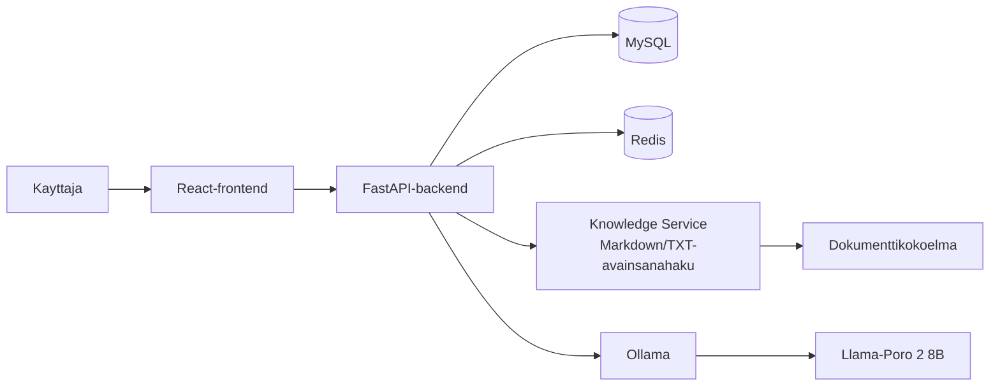
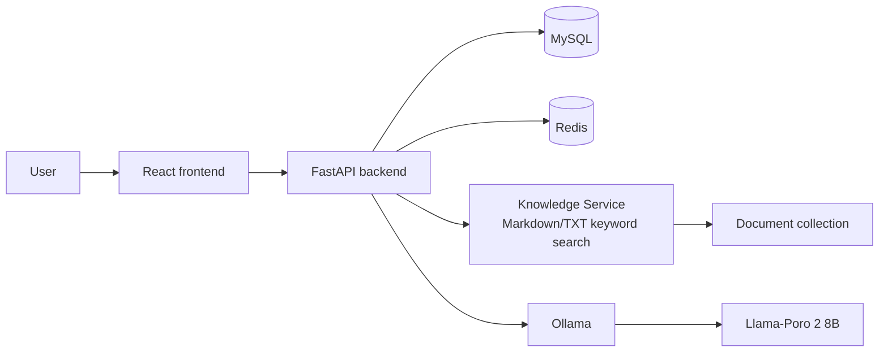

# AI HelpDesk

## Suomeksi

AI HelpDesk on kehitteillä oleva verkkopohjainen tukipalvelusovellus. Käyttäjä voi keskustella tekoälyn kanssa tietotekniikkaan ja ohjelmistokehitykseen liittyvistä ongelmista sekä hallita omia tukipyyntöjään.

> **Projektin tila:** Docker Compose käynnistää frontendin, FastAPI-backendin, MySQL:n, Redisin ja Ollaman paikalliseen kehityskäyttöön. Rekisteröityminen, kirjautuminen ja uloskirjautuminen on yhdistetty backendin istuntoautentikointiin. Chat ja tukipyynnöt ovat vielä käyttöliittymän esikatselunäkymiä.

### Keskeiset ominaisuudet

- Käyttäjätilin luominen ja kirjautuminen; käyttäjätietojen tarkastelu.
- Tekoälychat ja keskusteluhistoria.
- Tukipyyntöjen luominen, tarkastelu ja sulkeminen.
- Tukipyynnön luominen AI-keskustelusta vasta käyttäjän tarkistuksen ja vahvistuksen jälkeen.
- Etusivun rajattu yhteenveto käyttäjän omista tukipyynnöistä: kokonaismäärä sekä `OPEN`- ja `CLOSED`-määrät.
- Suomen- ja englanninkielinen käyttöliittymä.
- RAG-neuvonta rajatusta Markdown- ja TXT-dokumenttikokoelmasta avainsanahaulla. Semanttista hakua harkitaan vain, jos testit osoittavat avainsanahaun riittämättömäksi.
- Kehitys- ja esittely-ympäristön käynnistäminen Docker Composella, mukaan lukien Ollama ja valittu tekoälymalli.

### Teknologiapino

- Frontend: React ja TypeScript
- Backend: Python ja FastAPI
- Tietokanta: MySQL
- Kirjautumisen käyttörajoitukset: Redis
- Tekoälypalvelu: Ollama Docker Compose -ympäristössä
- Tekoälymalli: `Llama-Poro-2-8B-Instruct.Q4_K_M.gguf`
- Kontitus: Docker Compose

Työkalujen ja kirjastojen tulee olla maksuttomia. Niiden sekä tekoälymallin lisenssit ja käyttöehdot tarkistetaan ennen toimitusta.

Ollama-ympäristö testataan projektissa NVIDIA-GPU:lla. Muiden GPU-valmistajien tai -tyyppien yhteensopivuutta ei varmenneta tässä projektissa; niiden käyttöä haluava käyttäjä testaa yhteensopivuuden itse.

### Arkkitehtuurin yleiskuva

Frontend käyttää backendin REST-rajapintaa. Backend käsittelee liiketoimintalogiikan ja tietokantayhteyden sekä kutsuu Ollamaa Docker Compose -verkon kautta. MySQL tallentaa käyttäjät ja palvelinpuolen kirjautumisistunnot. Redis jakaa kirjautumisyritysten käyttörajat backend-pyyntöjen välillä. RAG-haku käsittelee sovittua Markdown- ja TXT-lähdekokoelmaa avainsanoilla.



### Projektidokumentaatio

- [Projektinhallinta](docs/00-projektinhallinta.md)
- [Vaatimusmäärittely](docs/01-vaatimusmaarittely.md)
- [Käyttäjätarinat ja hyväksymiskriteerit](<docs/02-k%C3%A4ytt%C3%A4j%C3%A4tarinat%20ja%20hyv%C3%A4ksymiskriteerit.md>)
- [Product Backlog](<docs/03-product%20backlog.md>)
- [Sprint-suunnitelma](<docs/04-sprintin%20suunnitelma.md>)
- [Järjestelmän suunnittelu](<docs/05-j%C3%A4rjestelm%C3%A4n%20suunnittelu.md>)
- [UX/UI-suunnittelu](docs/06-ux-ui-suunnittelu.md)
- [Ollama-mallin Modelfile](agents/Modelfile)

### Edellytykset

Käynnistys edellyttää Dockeria ja Docker Composea. Luo paikallinen `.env` kopioimalla esimerkkitiedosto ja aseta tietokantatunnukset sekä vähintään 32-merkkinen satunnainen `JWT_SECRET_KEY`.

```powershell
if (-not (Test-Path .env)) { Copy-Item .env.example .env }
```

### Asennus ja käynnistäminen

Käynnistä frontend, backend, MySQL, Redis ja Ollama yhdellä komennolla:

```powershell
docker compose up --build
```

Paikalliseen HTTP-kehitykseen aseta `.env`-tiedostossa `AUTH_COOKIE_SECURE=false`. Tämä Compose-asetus rajaa frontendin ja backendin `127.0.0.1`-osoitteeseen; sovellus ei tällä asetuksella ole muiden lähiverkon laitteiden käytettävissä. Frontend välittää `/api`-pyynnöt samalle alkuperälle. Compose-ympäristössä frontend käyttää vain erillistä proxy-verkkoa osoitteella `172.30.0.2` ja ottaa backend-yhteyden verkkoaliaksella `backend-proxy`, joten yhteys käyttää sitä verkkorajapintaa, jonka backend tunnistaa luotetuksi. `TRUSTED_PROXY_IPS`-asetuksen oletusarvo rajaa luottamuksen frontendin IP-osoitteeseen. Backend käyttää asiakkaan IP:nä luotetulta proxylta välitetyn ketjun ensimmäistä luottamatonta osoitetta. Jos muutat Compose-verkon tai proxyn osoitetta, päivitä myös `TRUSTED_PROXY_IPS`. Vanhentuneet kirjautumisistunnot siivotaan erillisessä taustatehtävässä tunnin välein, ei kirjautumisen yhteydessä. Nykyistä IP-välitystä ei ole vielä varmennettu kahdella oikealla LAN-laitteella. HTTPS-käyttöönotossa käytä `AUTH_COOKIE_SECURE=true`, aseta `FRONTEND_ORIGINS` sisältämään sovelluksen tarkka HTTPS-alkuperä ja käytä HTTPS:ää tarjoavaa reverse proxyä; määritä myös kyseisen proxyn luottamus erikseen. Aseta `VITE_API_BASE_URL` vain, jos backendin API on eri alkuperässä; arvon tulee olla backendin alkuperäosoite ilman `/api`-polkua.

Backend ajaa `alembic upgrade head` -migraatiot automaattisesti ennen käynnistymistä. Ensimmäinen baseline-migraatio luo `users`- ja `auth_sessions`-taulut uuteen tietokantaan tai ottaa aiemman käynnistystavan luomat taulut käyttöön niitä muuttamatta. Varmista aiemman version tietokannan skeema ja ota MySQL-volyymista varmuuskopio ennen päivitystä. Alembicin automaattisesti generoima migraatio on ehdotus: tarkista migraatiotiedosto ennen sen yhdistämistä.

LAN-käytössä lisää `FRONTEND_ORIGINS`-asetukseen sovelluksen tarkka alkuperä, esimerkiksi `http://helpdesk.lan:8088`, ja pidä logoutin `Origin`-tarkistus käytössä. Suosi HTTPS:ää ja `AUTH_COOKIE_SECURE=true`-asetusta istuntokeksin suojaamiseksi.

### Testaus

Frontendin tyypitys, tuotantobuild ja lint-tarkistukset voi suorittaa näin:

```powershell
cd frontend
npm run build
npm run lint
```

Backendin proxy-käsittelyn ja vanhentuneiden istuntojen siivouskyselyn yksikkötestit voi ajaa projektin juuresta Dockerilla:

```powershell
docker compose exec backend python -m unittest discover -s tests -v
```

Testit kattavat luotetun ja luottamattoman proxyn, proxy-ketjun, asiakkaiden erilliset IP-avaimet, puuttuvat ja virheelliset välitysotsakkeet sekä sen, että vanhentuneet istunnot poistetaan erillisellä ensisijavainkyselyllä. Ne eivät korvaa oikeassa LAN-verkossa tehtävää välitystestiä tai rinnakkaisten kirjautumisten testiä MySQL:llä. Keskeisten toimintojen hyväksymiskriteerit ja muut suunnitellut testit on kuvattu käyttäjätarinoissa ja vaatimusmäärittelyssä. Rekisteröityminen ja istuntopohjainen kirjautuminen toimivat; chat- ja tukipyyntötoiminnot odottavat backend-integraatiota.
Uudet rate limiting -testit tarkistavat IP-yritysten laskennan, sähköpostin epäonnistumislaskurin, rajat, Redis-virheen sekä sen, ettei onnistunut kirjautuminen kasvata sähköpostin virhelaskuria.

### Kuvat

Sovelluksen käyttöliittymän kuvakaappaukset lisätään toteutuksen valmistuttua. Arkkitehtuuri- ja käyttöliittymäsuunnitelmat löytyvät [järjestelmän suunnittelusta](<docs/05-j%C3%A4rjestelm%C3%A4n%20suunnittelu.md>) ja [UX/UI-suunnittelusta](docs/06-ux-ui-suunnittelu.md).

### Lisenssi

Projektin lisenssiä ei ole vielä määritelty. Myös kolmannen osapuolen mallien, työkalujen ja kirjastojen lisenssit sekä käyttöehdot tarkistetaan ennen julkaisua.

---

## English

AI HelpDesk is a web-based support application under development. Users can discuss IT and software development issues with an AI assistant and manage their own support tickets.

> **Project status:** Docker Compose starts the frontend, FastAPI backend, MySQL, Redis, and Ollama for local development. Registration, sign-in, and sign-out are connected to backend session authentication. Chat and support tickets are still frontend preview screens.

### Main features

- User registration and sign-in; viewing account details.
- AI chat and conversation history.
- Creating, viewing, and closing support tickets.
- Creating a ticket from an AI conversation only after the user reviews and confirms the proposed details.
- A limited dashboard for the signed-in user's tickets: total count and `OPEN`/`CLOSED` counts.
- Finnish and English user interface.
- RAG over a selected Markdown and TXT document collection using keyword search. Semantic search will only be considered if tests show that keyword search is insufficient.
- Starting the development and demo environment with Docker Compose, including Ollama and the selected AI model.

### Technology stack

- Frontend: React and TypeScript
- Backend: Python and FastAPI
- Database: MySQL
- Login rate limiting: Redis
- AI service: Ollama in the Docker Compose environment
- AI model: `Llama-Poro-2-8B-Instruct.Q4_K_M.gguf`
- Containerization: Docker Compose

Tools and libraries must be free of charge. Their licenses and terms of use, as well as those of the AI model, will be checked before delivery.

The Ollama environment is tested on NVIDIA GPUs. Compatibility with GPUs from other vendors or of other types is not verified by this project; users who want to use them are responsible for testing compatibility.

### Architecture overview

The frontend uses the backend REST API. The backend handles application logic and database access, and calls Ollama over the Docker Compose network. MySQL stores users and server-side login sessions. Redis shares login-attempt limits across backend requests. RAG searches the agreed Markdown and TXT document collection using keywords.



### Project documentation

- [Project management](docs/00-projektinhallinta.md)
- [Requirements specification](docs/01-vaatimusmaarittely.md)
- [User stories and acceptance criteria](<docs/02-k%C3%A4ytt%C3%A4j%C3%A4tarinat%20ja%20hyv%C3%A4ksymiskriteerit.md>)
- [Product Backlog](<docs/03-product%20backlog.md>)
- [Sprint plan](<docs/04-sprintin%20suunnitelma.md>)
- [System design](<docs/05-j%C3%A4rjestelm%C3%A4n%20suunnittelu.md>)
- [UX/UI design](docs/06-ux-ui-suunnittelu.md)
- [Ollama model Modelfile](agents/Modelfile)

### Prerequisites

The setup requires Docker and Docker Compose. Create a local `.env` from the example file and set the database credentials and a random `JWT_SECRET_KEY` of at least 32 characters.

```powershell
if (-not (Test-Path .env)) { Copy-Item .env.example .env }
```

### Installation and running

Start the frontend, backend, MySQL, Redis, and Ollama with:

```powershell
docker compose up --build
```

For local HTTP development, set `AUTH_COOKIE_SECURE=false` in `.env`. Compose binds the frontend and backend to `127.0.0.1`, so this setup is not accessible from other devices on the LAN. The frontend sends `/api` requests through the same-origin proxy. In Compose, the frontend uses only the dedicated proxy network at `172.30.0.2` and connects to the backend through the `backend-proxy` network alias, ensuring the connection uses the interface trusted by the backend. The default `TRUSTED_PROXY_IPS` value trusts only the frontend IP. The backend uses the first untrusted address in the chain forwarded by a trusted proxy as the client IP. If you change the Compose network or proxy address, update `TRUSTED_PROXY_IPS` as well. Expired login sessions are cleaned by a separate hourly background task, not during login. Forwarding has not yet been verified using two real LAN devices. For an HTTPS deployment, use `AUTH_COOKIE_SECURE=true`, set `FRONTEND_ORIGINS` to include the exact HTTPS application origin, and use an HTTPS reverse proxy; configure trust for that proxy separately. Set frontend `VITE_API_BASE_URL` only when the backend API uses a different origin; its value must be the backend origin without an `/api` path.

Before startup, the backend automatically runs `alembic upgrade head`. The initial baseline migration creates the `users` and `auth_sessions` tables in a new database or adopts tables created by the previous startup path without changing them. Verify the schema of a database created by an earlier version and back up the MySQL volume before upgrading. Alembic autogeneration produces a candidate migration; review each migration file before merging it.

For LAN access, add the exact application origin to `FRONTEND_ORIGINS`, for example `http://helpdesk.lan:8088`, and keep the logout `Origin` check enabled. Prefer HTTPS with `AUTH_COOKIE_SECURE=true` to protect the session cookie.

### Testing

Run the frontend type-check/production build and lint checks with:

```powershell
cd frontend
npm run build
npm run lint
```

Run the backend unit tests for proxy client-IP handling and expired-session cleanup from the project root using Docker:

```powershell
docker compose exec backend python -m unittest discover -s tests -v
```

The tests cover trusted and untrusted proxies, proxy chains, distinct client IP keys, missing or malformed forwarded headers, and cleanup by primary key outside the login transaction. They do not replace a forwarding test on a real LAN or a concurrent sign-in test against MySQL. Acceptance criteria and other planned tests for key features are described in the user stories and requirements specification. Registration and session-based sign-in are implemented; chat and support-ticket features still need backend integration.
The new rate limiting tests cover IP attempt counting, the email failure counter, both limits, Redis errors, and that successful login does not increment the email failure counter.

### Screenshots

Application screenshots will be added after the interface has been implemented. Architecture and interface design materials are available in the [system design](<docs/05-j%C3%A4rjestelm%C3%A4n%20suunnittelu.md>) and [UX/UI design](docs/06-ux-ui-suunnittelu.md) documents.

### License

The project license has not yet been defined. Licenses and terms of use for third-party models, tools, and libraries will also be checked before release.
