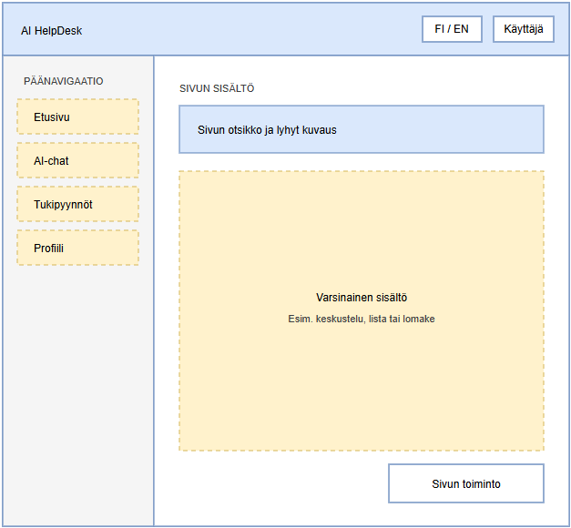
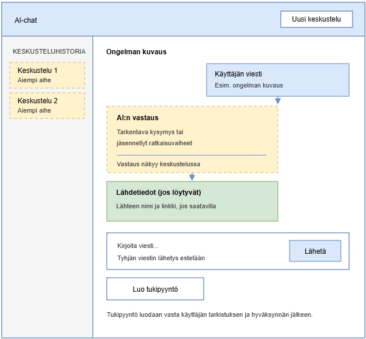

# AI HelpDesk - UX/UI Design

**Project:** AI HelpDesk – Student Project  
**Document:** UX/UI Design Specification  
**Version:** 1.0  
**Updated:** 26.10.2026  
**Status:** Design document – implementation and usability testing will be refined during the project

---

## 1. Purpose and Scope

The purpose of this document is to define the structure of the AI HelpDesk system's user interface, key user journeys, user interface components, and usability requirements. The document supplements the requirements specification, user stories, Product Backlog, and system design.

The UX/UI design focuses on ensuring that users can:
- log in and manage their own user information;
- describe an IT problem in AI chat and answer clarifying questions;
- follow the instructions they receive and view possible sources of information;
- create a support ticket based on a conversation or independently;
- view and close their own support tickets;
- use the user interface in Finnish or English.

This document defines the functional user interface design, not the final visual implementation. Colors, icons, typography, and precise dimensions can be finalized during implementation. However, the user interface must follow the structure and behavior defined here.

### 1.1 Design Principles

1. **Task first:** users must be able to find AI chat and their own support tickets without unnecessary navigation.
2. **Clear next step:** each view has a recognizable main purpose and primary action.
3. **User controls the support ticket:** a support ticket is not created automatically from a conversation. The user reviews and approves the information before it is saved.
4. **Transparent AI:** AI responses, clarifying questions, and information sources are visually distinguished from one another.
5. **Recoverable errors:** after an error message, user-entered content is retained whenever technically possible.
6. **Privacy and permissions:** users see only their own information and support tickets.
7. **Bilingual from the start:** all user interface text is implemented using translation keys.
8. **Agreed scope:** the user interface is kept appropriate to the project's scope. User stories included in the official delivery scope are not treated as optional; new features require a separate decision.

## 2. Users and Key Use Cases

### 2.1 Primary User

**A student or other system user** with an IT- or software-development-related problem. They want to receive understandable solution instructions and, if necessary, open a support ticket whose status they can track.

### 2.2 Key Use Cases

| Use Case | User's Goal | Expected Outcome |
|---|---|---|
| Registration and login | Gain access to the service | The user can access their own views |
| Using AI assistance | Solve an IT problem | The AI provides instructions and asks for additional information when necessary |
| Viewing conversation history | Return to a previous conversation | Previous messages are displayed in the correct order |
| Creating a support ticket | Request further assistance | The support ticket is saved and its identifying information is displayed |
| Viewing support tickets | Track the user's own requests | The user sees their own open and closed tickets |
| Closing a support ticket | Mark an issue as resolved | The support ticket status changes to closed |
| Managing profile and language | Update personal settings | Changes are saved and the selected language is applied |

## 3. Main User Journeys

### 3.1 From AI Assistance to a Solution or Support Ticket

1. The user logs in.
2. The user opens AI chat and describes the problem in their own words.
3. The AI responds or asks clarifying questions to investigate the problem.
4. The user answers the clarifying questions.
5. The AI suggests solution instructions step by step.
6. If knowledge-based search finds a suitable source, the user interface displays the source information with the response.
7. The user tries the instructions.
8. If the problem is resolved, the user can end the conversation or continue asking questions.
9. If the problem is not resolved, the user selects **Create support ticket**.
10. The system opens a form prefilled with a suggested title and description based on the conversation.
11. The user reviews and, if necessary, edits the information, selects a priority, and confirms creation.
12. Only after confirmation does the system save the support ticket and display a success notification and a link to the support ticket details.

**UX Requirements**
- A support ticket is not created without the user's explicit confirmation; cancelling or leaving the form does not save the ticket.
- The user can edit the automatically suggested title and description.
- The original conversation messages are retained even if the AI response fails.
- If no information source is found, the user interface clearly states this and does not present the response as supported by a documented source.

### 3.2 Creating a Support Ticket Without an AI Conversation

1. The user opens **Support tickets**.
2. The user selects **New support ticket**.
3. The user fills in the title, description, and priority.
4. The user submits the form.
5. The system validates the information and saves the support ticket.
6. The user interface displays a success message and the new support ticket details.

### 3.3 Closing a Support Ticket

1. The user opens their own open support ticket.
2. The user selects **Close support ticket**.
3. The user interface asks for confirmation if closing is difficult to reverse or could be done accidentally.
4. The system saves the status as `CLOSED`.
5. The user interface displays the new status.

## 4. Information Architecture and Navigation

### 4.1 Main Navigation

The logged-in user's main navigation contains the following items:

- **Home** – a concise landing view and the most important shortcuts.
- **AI chat** – a new conversation and access to previous conversations.
- **Support tickets** – a list of the user's own support tickets and their details.
- **Profile** – user information, user interface language, and logout.

Navigation labels and locations remain the same in all views for logged-in users. The current view is indicated visually and, where necessary, with an accessible state.

### 4.2 Page Structure

```text
AI HelpDesk
├── Public views
│   ├── Login
│   └── Registration
└── Logged-in user views
    ├── Home
    ├── AI chat
    │   ├── New conversation
    │   └── Conversation history / conversation content
    ├── Support tickets
    │   ├── Support ticket list
    │   ├── New support ticket
    │   └── Support ticket details
    └── Profile
        ├── User information
        └── User interface language
```

## 5. General User Interface Structure

### 5.1 Desktop View

Logged-in user views use a common application frame:
- main navigation on the left;
- the application name, language control if needed, and user menu at the top;
- the page title and main content in the center;
- action buttons placed close to the content they apply to.

Example layout:



### 5.2 Responsiveness

- The user interface must be usable both on a computer and on a narrow screen.
- On a narrow screen, the page navigation can be changed to a collapsible menu.
- Forms and the conversation input field must not require horizontal scrolling.
- The support ticket table can be displayed as a card list on mobile.
- Primary actions must not be hidden solely because of a sidebar that is visible only on a wide screen.

## 6. Page-Specific UX/UI Specifications

### 6.1 Login

**Purpose:** give a registered user access to the service.

**Content**
- application name and a short description;
- email address;
- password;
- **Log in** button;
- link to registration;
- error and loading states.

**Behavior**
- Required fields are validated.
- During login, the button shows a loading state and prevents accidental repeated submissions.
- The error message is understandable and does not reveal whether a particular email address is registered if that would create a security risk.
- After successful login, the user is taken to the home page or to the previously requested protected view.

**Empty and Error States**
- invalid or missing fields;
- incorrect login credentials;
- server or network error;
- login processing in progress.

### 6.2 Registration

**Purpose:** create a new user account.

**Content**
- first name;
- last name;
- username;
- email address;
- password;
- **Create account** button;
- link to login;
- field-specific validation messages.

**Behavior**
- Required fields and password requirements are explained before submission.
- The user receives clear feedback on success or failure.
- After success, the user is directed to a logged-in view or the login page according to the defined authentication flow.

### 6.3 Home

**Purpose:** quickly direct the user to the most important task.

**Content**
- a greeting or short description of the service;
- primary **Start an AI conversation** button;
- link to the user's own support tickets;
- a limited summary of the total number of the user's own support tickets and the counts in `OPEN` and `CLOSED` status (US-14).

**Prioritization**
The home page is kept simple, and the US-14 summary is a mandatory part of the agreed delivery scope. It displays only the total and the `OPEN` and `CLOSED` counts. A comprehensive analytics panel, complex charts, filters, time-period comparisons, and a separate highlight of the latest support tickets are not included in this specification.

### 6.4 AI Chat

**Purpose:** help the user investigate an IT problem through conversation.

**Content**
- conversation title or identifier;
- message area;
- user and AI messages, clearly distinguished;
- input field;
- **Send** button;
- **New conversation** action;
- access to conversation history;
- **Create support ticket** action;
- source information next to an AI response when RAG search finds a usable source.

**Message Presentation**
- User messages and AI responses are distinguished both visually and textually.
- AI clarifying questions are presented in the conversation in the same way as other AI messages.
- Long responses are structured with headings, numbered steps, and readable paragraphs.
- Source information is presented as a separate part of the response, for example with the source name and a link if available.
- A source is not displayed if it has not actually been found.

**Behavior**
- Sending an empty message is prevented.
- A loading state is displayed while a message is being sent.
- The user receives feedback while a response is being generated.
- After an error, the user's entered text is retained and they can try sending it again.
- The user is notified if saving conversation history fails.
- Conversation messages are displayed in chronological order.
- The user can start a new conversation without losing previous saved conversations.

**Recommended Layout**



On mobile, conversation history can be opened from a separate button so that the main conversation area remains sufficiently wide.

### 6.5 Support Ticket List

**Purpose:** show the user their own support tickets.

**Content**
- page title **Support tickets**;
- **New support ticket** button;
- a list or table showing title, status, priority, and creation time;
- empty, loading, and error states for the list.

**Statuses and Priorities**
- statuses: `OPEN` and `CLOSED`;
- priorities: `LOW`, `MEDIUM`, and `HIGH`.

Statuses are shown to the user in the selected user interface language, even though technical values are used in the database. For example, `OPEN` is displayed as **Avoin** in Finnish and **Open** in English.

**Behavior**
- Selecting a support ticket title or row opens the detail view.
- The user sees only their own support tickets.
- An empty list displays guidance text and an action to create a new support ticket.
- Loading and error states are shown separately.

### 6.6 New Support Ticket

**Purpose:** save the user's problem as a support ticket.

**Fields**
- title;
- description;
- priority (`LOW`, `MEDIUM`, `HIGH`);
- **Create support ticket** button;
- **Cancel** action.

**Behavior**
- The title and description are required.
- A validation error is displayed next to the relevant field.
- Accidental duplicate submissions are prevented while the form is being submitted.
- After success, a confirmation and a link to the created support ticket are displayed.
- Entered information is retained in case of an error.

If the form is opened from an AI conversation, the title and description can be prefilled based on the conversation. The user can edit them before saving.

### 6.7 Support Ticket Details

**Purpose:** display the details of one support ticket and offer an allowed action.

**Content**
- title and description;
- status;
- priority;
- creation time;
- a possible link to the related conversation, if the relationship is saved;
- **Close support ticket** button for an open ticket.

**Behavior**
- The close action is available only for an open support ticket.
- After closing, the status is updated in the view.
- An active close button is not displayed for a closed support ticket.
- If the support ticket is not found or the user is not authorized to access it, a secure error view is displayed without information about other users.

### 6.8 Conversation History

**Purpose:** allow the user to return to a previous AI conversation.

**Content**
- a list of saved conversations;
- conversation title or short identifier;
- time of the most recent message, if available;
- messages in the selected conversation.

**Behavior**
- Conversations are ordered consistently, for example by the time of the most recent message.
- Selecting a conversation opens it with its messages.
- If the history is empty, instructions for starting a new conversation are displayed.
- The user cannot open another user's conversation.

### 6.9 Profile and Language Setting

**Purpose:** display the user's information and allow them to manage the user interface language.

**Content**
- the user's saved information;
- editing actions only for information that is allowed to be edited according to the requirements;
- language selection: Finnish / English;
- **Save changes** button, if there is information to change;
- **Log out** action.

**Bilingual Support**
- Changing the language updates the user interface text without requiring the user to log in again.
- The selection is retained for the next use, for example in the browser's local storage.
- Language selection must not be implemented in only one view: navigation, forms, validation messages, buttons, statuses, and error messages are also translated.
- The user interface language and the language of the AI response are different things. The conversation language or user selection is clearly passed to the AI, but the language of AI responses must not be based only on the language used in an individual user interface text.

## 7. Shared User Interface Components

| Component | Purpose | Behavior |
|---|---|---|
| Main navigation | Moving between main pages | The current page is clearly distinguished |
| Primary button | The page's most important action | One clear primary action at a time |
| Secondary button/link | Cancelling or an alternative action | Does not visually compete with the primary action |
| Form field | Entering information | Label, instructions if needed, and field-specific error |
| Status indicator | Displaying support ticket status | Text and visual distinction; not color alone |
| Message bubble/card | User and AI messages | Sender is identifiable without relying on color |
| Source card | Displaying a RAG source | Source name and link, if available |
| Notification | Success, warning, or error | Brief, understandable, and action-oriented |
| Empty state | No content is available | Explains the situation and offers the next action |
| Loading state | A request is in progress | Prevents repeated submissions and indicates that the user should wait |

## 8. Bilingual Support and Accessibility

### 8.1 Translations

All user interface text is implemented using translation keys rather than text written directly in components. Examples:

```text
nav.home
nav.chat
nav.tickets
nav.profile
auth.login
auth.register
ticket.status.open
ticket.status.closed
ticket.priority.low
ticket.priority.medium
ticket.priority.high
chat.send
chat.newConversation
chat.createTicket
common.save
common.cancel
common.loading
error.generic
```

Finnish and English equivalents are maintained centrally. When adding new user interface text, both languages are checked.

### 8.2 Basic Accessibility Requirements

- All form fields have a visible or programmatically associated name.
- Button text describes the action; unclear icons alone are avoided.
- Text and background contrast is sufficient.
- The meaning of status or priority is not conveyed by color alone.
- The user interface can be used with a keyboard.
- The location of focus is clearly visible.
- Error messages are understandable and associated with the correct field or action.
- Heading levels follow a logical order.
- Dynamic loading and success messages are presented in a way that assistive technologies can detect where possible.

## 9. User Interface States and Error Situations

At least the following states are considered in each view that retrieves or saves information:

| State | User Interface Behavior |
|---|---|
| Loading | A loading indicator is displayed and unnecessary duplicate submissions are prevented |
| Success | The user is told what was saved or what happened |
| Validation error | The error to be corrected is displayed near the field |
| Network error | The user is told that the action could not be completed and is offered a retry |
| No content | The user is told that there is no information yet and is offered the next action |
| No permission | A secure notification is displayed without revealing protected information |
| AI service error | The user's text is retained and a retry is offered |
| No RAG source found | The user is told that no suitable source was found; no source is fabricated |
| Session expired | The user is directed to log in again, while avoiding unnecessary loss of entered information |

An error message must tell the user:
1. what happened;
2. whether the user can do anything;
3. whether the entered information was retained, if relevant to the situation.

Technical stack traces, database errors, or other internal details are not shown to end users.

## 10. Privacy and Trust in the User Interface

- Views that require login are not visible to a logged-out user.
- The user interface does not rely solely on hiding other users' information in navigation. The backend checks permissions on every protected request.
- Support ticket and conversation details are displayed only to an authorized user.
- The user is clearly informed when a support ticket is saved.
- AI-generated instructions are presented as suggestions. The user is not given the false impression that AI is always correct.
- A RAG source is shown only if the search returns a real source.
- Passwords or unnecessary personal information are not displayed in the user interface.

## 11. UX/UI Acceptance Criteria

The following criteria supplement the acceptance criteria for user stories. They do not replace the functional requirements defined in the user stories.

| ID | Acceptance Criterion | Test |
|---|---|---|
| UX-01 | Login and registration forms have clear field names and understandable error messages. | Test empty fields and invalid information |
| UX-02 | The logged-in user's main navigation remains consistent from one view to another. | Navigate between all main pages |
| UX-03 | The user can distinguish their own messages from AI messages. | View at least one conversation |
| UX-04 | In AI chat, the user can send a message, see a loading state, and continue after an error. | Test success and a simulated error |
| UX-05 | A support ticket is not created from an AI conversation without the user's review and approval. | Start creation and cancel before saving |
| UX-06 | The support ticket's title, description, status, priority, and creation time can be found. | Open the support ticket list and details |
| UX-07 | The user can close an open support ticket, and the status is visibly updated. | Close a test support ticket |
| UX-08 | Empty list, loading, and error states are presented separately. | Test with an empty user account and in an error situation |
| UX-09 | The user interface language can be switched between Finnish and English. | Change the language in different views |
| UX-10 | The language selection persists for the next use according to the implementation solution. | Refresh the page or reopen the application |
| UX-11 | A RAG source is shown with the response only when the source is actually available. | Test a found source and a source that is not found |
| UX-12 | The most important user interface actions work on a narrow screen without unnecessary horizontal scrolling. | Test at a narrow browser window width |
| UX-13 | Support ticket status and priority are not distinguished by color alone. | Check text and visual labels |
| UX-14 | The user sees only their own support tickets and conversations. | Test with two different test users |
| UX-15 | The user's message is retained after an AI service error if it has already been written or sent. | Simulate an AI service error |
| UX-16 | The home page displays only the logged-in user's total support ticket count and `OPEN` and `CLOSED` counts; values for an empty account are zero. | Test an account with tickets and an empty account; compare counts with the database |

## 12. Usability Testing Plan

Testing is performed in the development environment during the project. Test users and test data are used, not real sensitive personal information.

### 12.1 Test Scenarios

1. **Login:** the user logs in with correct and incorrect credentials.
2. **AI assistance:** the user describes a problem, answers a clarifying question, and reads a suggested solution.
3. **Creating a support ticket:** the user creates a ticket from an AI conversation, reviews the prefilled information, and approves saving it.
4. **Managing a support ticket:** the user finds a ticket in the list, opens it, and closes it.
5. **Conversation history:** the user opens a previous conversation.
6. **Changing language:** the user changes from Finnish to English and back.
7. **Error situations:** the user encounters a network or AI service error and can continue.
8. **Permissions:** information belonging to two test users is not visible to the other.
9. **Mobile view:** the user performs the most important actions on a narrow screen.

### 12.2 Recording Test Results

For each test, record:
- test date;
- feature tested;
- expected result;
- actual result;
- issue observed;
- corrective action and status.

The objective of usability testing is to find problems that prevent users from completing a task before the project is submitted. Testing can be performed as a developer's own checklist and, where possible, with another person who did not implement the view in question.

## 13. Implementation Order and Relationship to Sprints

UX/UI work is carried out in stages alongside other development. The precise implementation order is aligned with the Sprint plan and Product Backlog.

| Phase | UX/UI Work | Related Functionality |
|---|---|---|
| Sprint 1 | General application frame, navigation, basic structure for login and registration, translation key foundation | Basic structure and authentication |
| Sprint 2 | Support ticket list, creation form, details, and profile | Support ticket management |
| Sprint 3 | AI chat message area, input field, loading and error states, conversation history | AI conversation |
| Sprint 4 | Conversation-to-support-ticket journey, completing bilingual support, usability testing | Integration and language support |
| Sprint 5 | RAG source cards, state for responses without sources, end-to-end journey testing | Knowledge-based AI assistance |

The implementation order follows the agreed Sprint allocation and technical dependencies. Docker Compose includes the frontend, backend, MySQL, and Ollama with the selected model. Creating a support ticket from a conversation (US-09) requires the user to review and confirm the information; the limited summary on the home page (US-14) is part of the delivery. The three selected additional features (Docker Compose including the Ollama service, Finnish- and English-language user interface, and RAG), as well as US-09 and US-14, are commitments in the final delivery scope.

## 14. Limitations and Further Development

The following are outside the scope of the first version of this UX/UI specification:
- a detailed visual brand guide;
- a final pixel-perfect prototype;
- voice or speech user interface;
- PDF export;
- a comprehensive analytics or administration dashboard;
- complex user roles or an administrator management view, unless added to the requirements specification.

The limited US-14 summary on the home page is part of the delivery scope. Comprehensive analytics features and other dashboard extensions not specified in this document are outside its scope. Any new features are first recorded in the Product Backlog and approved through change management.

## 15. Relationship to Other Project Documents

This document supplements the following documents:
- [Project Management](../../docs/00-projektinhallinta.md) – project management, objectives, scope, and risks;
- [Requirements Specification](../../docs/01-vaatimusmaarittely.md) – functional and non-functional requirements;
- [User Stories and Acceptance Criteria](02-käyttäjätarinat%20ja%20hyväksymiskriteerit.md) – user stories and acceptance criteria;
- [Product Backlog](../../docs/03-product%20backlog.md) – prioritized development tasks;
- [Sprint Plan](../../docs/04-sprintin%20suunnitelma.md) – Sprint goals and tasks;
- [System Design](05-järjestelmän%20suunnittelu.md) – architecture, responsibilities, and API structure.

If a conflict is found between this document and the requirements specification, it must be reviewed before implementation and changes must be recorded in the appropriate documents.

---

## Change History

| Version | Date | Change |
|---|---|---|
| 1.0 | 26.10.2026 | First UX/UI design specification |
