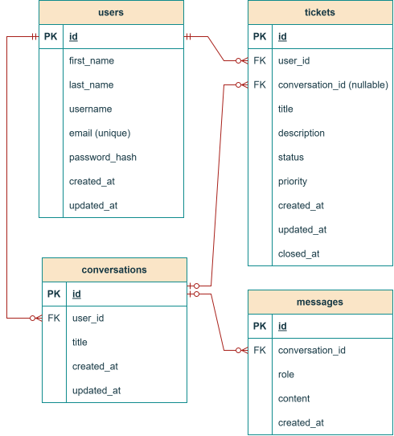

# AI HelpDesk – System Design

## 1. Introduction

### 1.1 Purpose of This Document

This document describes the technical design of the AI HelpDesk application. It defines the system architecture, database structure, relationships between database entities, REST API, and the key user interface views.

The design aims to create a clear and maintainable structure that supports the application's key features:

- User registration and login.
- User profile management.
- Creating and managing support tickets.
- AI-powered conversation.
- Persistent storage of conversation messages.
- Creating a support ticket based on a conversation.
- Knowledge-based AI assistance, in which the Knowledge Service retrieves technical documentation related to the conversation.
- A Finnish- and English-language user interface.
- Starting the frontend, backend, MySQL database, Redis, and Ollama AI service with a single Docker Compose command.
- Creating a support ticket from a conversation only after the user has reviewed and confirmed it, and a limited summary of the user's own support tickets.

### 1.2 System Objectives

The objective of the AI HelpDesk application is to provide users with a single service where technical problems can be solved with the help of AI and, when necessary, unresolved problems can be transferred to support ticket handling.

The system must be:

- **Secure:** users can access only information they are authorized to access.
- **Maintainable:** the user interface, backend, database, and AI integration are clearly separated.
- **Extensible:** new features can be added without redesigning the entire system.
- **Reliable:** errors are handled in a controlled manner and users receive understandable feedback.
- **Testable:** unit and integration tests can be implemented for key features.

### 1.3 User Roles

| Role | Description |
|---------|---------|
| Registered user | Manages their profile, chats with the AI, and manages their own support tickets. |
| Application developer | Implements, tests, maintains, and documents the system. |

The developer role describes technical responsibility for the project and does not automatically imply a separate application administrator role.

---

## 2. System Architecture

### 2.1 Architecture Overview

AI HelpDesk will be implemented as a layered web application. The frontend is responsible for the user interface, the backend for business logic and security checks, and the database for persistent storage. The AI service is used to analyze technical problems and generate suggested solutions.


The architecture diagram will remain structurally unchanged. The selected additional features are reflected in it and in the implementation scope as follows:

- **RAG:** Chat Service uses Knowledge Service, which searches a limited collection of Markdown and TXT documents by keywords. The found content and actual source information are passed to AI Service and displayed with the response. If no suitable content is found, the response is not presented as being supported by documentation. Semantic search is not part of the MVP and will be considered only on the basis of test evidence.
- **Multilingual support:** Frontend user interface text is available in Finnish and English. The language selection is retained in the browser; the AI response language is determined by the conversation language and the agent's language instructions.
- **Docker Compose:** the frontend, backend, MySQL, and Ollama are started with one command documented in the README. Ollama uses the selected GGUF model in the Docker environment, and running the AI service does not depend on Ollama being installed on the host machine.
- **Authentication:** registration, sign-in, and sign-out are implemented. Login sessions are stored in MySQL and login-attempt limits are shared through Redis.
- **Proxy and IP rate limit:** in the Compose development environment, the frontend uses only the dedicated proxy network, has the fixed address `172.30.0.2`, and forwards `/api` requests to the backend through the `backend-proxy` network alias. The backend reads the `X-Forwarded-For` header only when the direct peer address belongs to the trusted IP network configured through `TRUSTED_PROXY_IPS`. The chain is processed from right to left; trusted proxy hops are skipped and the first untrusted address is used as the client IP. Forwarded headers from other peers are ignored.
- **Delivery scope:** US-09 and US-14 are official user stories. A support ticket is created from a conversation only after the user has reviewed and confirmed it; the summary shows only the user's own total, `OPEN`, and `CLOSED` counts.

### 2.2 Frontend

The frontend provides users with a visual user interface and sends their actions to the backend through the REST API.

#### Frontend Responsibilities

- Registration and login views.
- Viewing and updating the user profile.
- Creating, viewing, and closing support tickets.
- Displaying the AI conversation.
- Displaying conversation history.
- Preliminary validation of form input.
- Displaying success and error messages.
- Supporting a Finnish- and English-language user interface.

The frontend is not responsible for the final permission checks. All checks related to handling protected data are performed by the backend.

### 2.3 Backend

The backend provides the REST API and implements the application's business logic.

#### Backend Responsibilities

- User registration and login.
- Authentication and permission checks.
- Request validation.
- Handling support tickets and conversation messages.
- Reading and saving data in the database.
- Calling the AI service and processing responses.
- Error handling.
- Returning consistent HTTP responses from the API.

#### Backend Logical Components

| Component | Responsibility |
|------------|---------|
| Auth Service | User authentication and permissions |
| User Service | Profile information management |
| Ticket Service | Creating and updating support tickets |
| Chat Service | Handling conversations and messages |
| AI Service | AI service integration |
| Knowledge Service | Retrieving technical documentation for RAG responses |

These are logical components, not necessarily separate servers or microservices.

### 2.4 Database

The system uses a MySQL database as its primary relational database.

The database stores:

- User information.
- Active login sessions and their expiration times.
- Support tickets and their statuses.
- Conversations.
- Conversation messages.
- Required creation and update timestamps.

Database referential integrity is ensured with primary and foreign keys. User-specific queries use filters based on the authenticated user's ownership.

### 2.5 AI Integration

AI Service forwards the user's message to the Ollama service running in the Compose environment and processes the response. The model used is `Llama-Poro-2-8B-Instruct.Q4_K_M.gguf`, whose configuration is in the [Modelfile](../../agents/Modelfile). The model's context length is 4096 and its temperature is 0.2.

#### The AI Integration Must

- Call Ollama from the backend using the service name and API within the Compose network; the browser does not call Ollama directly.
- Run Ollama as a Compose service and use a health check to ensure that the service and selected model are available.
- Make the GGUF model file available to the Ollama container in a documented way. The current design mounts the model file from the `agents` directory into the container as read-only; the `Modelfile` uses the container path `/models/Llama-Poro-2-8B-Instruct.Q4_K_M.gguf`.
- Automatically create the selected model in Ollama at Compose startup based on the `Modelfile`, if the model is not already in Ollama's model store.
- Retain Ollama's model store in a persistent Docker volume so that restarting the service does not require the model to be imported manually again.
- Handle timeouts, service errors, and usage limits.
- Limit the amount of conversation context sent to the AI.
- Save conversation messages in accordance with the application's defined data retention practices.
- Avoid sending unnecessary personal data to the model.

AI-generated responses are suggestions. Their accuracy cannot be guaranteed in all situations.

### 2.6 RAG MVP and Data Sources

Knowledge Service processes a collection of Markdown and TXT documents that the group has limited and approved for use before implementation. The exact source collection and its storage location will be confirmed before implementation; documents will not be retrieved from unspecified or external sources.

The MVP search method is keyword search. The service retrieves document passages relevant to the question, forwards the found text excerpts and source information through Chat Service to AI Service, and returns the source information for display in the user interface. The source information for a search result is based on the actual file and the passage found. If no suitable passage is found, no fabricated source is provided to the model, and the response is not presented as being supported by documentation.

The quality of keyword search will be assessed using questions and documents defined before implementation, including tests for a relevant match and a query with no match. Semantic search or a vector database will be added only if test results show keyword search to be insufficient and the change is approved. The RAG MVP document collection and search method do not require changes to the ER diagram or MySQL schema. If a genuine need for new persistent data arises later, the data model and ER diagram will be updated separately through change management.

The model, Ollama, Docker images, and other tools and libraries will be checked for cost, licenses, and terms of use before delivery. Compliance with any license terms will not be assumed without verification.

---

## 3. ER Diagram

### 3.1 Entities and Their Relationships

The system's key entities are User, Ticket, Conversation, and Message.



The diagram is maintained unchanged as a high-level view of the database tables and their relationships. The tables below specify the field names and constraints in more detail. They also include the `tickets.created_at` and `tickets.updated_at` fields, the `conversations.created_at` and `conversations.updated_at` fields, and the `messages.created_at` field, which are not marked in the diagram. A support ticket creation time is required to meet FR-05; the other timestamps support displaying history and maintaining the data.

### 3.2 Entity Descriptions

#### User

Contains information related to user authentication and profile. The email address is unique, and the password is stored only as a securely hashed value.

#### Ticket

Contains the support ticket title, description, status, priority, and owner. Each support ticket belongs to one user.

#### Conversation

Represents one user's conversation thread. A conversation belongs to one user and can contain multiple messages.

#### Message

Contains an individual message associated with a conversation. The message role indicates whether it is a user message or an AI response.

### 3.3 Cardinalities

| Relationship | Cardinality | Description |
|---------|---------|---------|
| User – Ticket | User 1 → 0..N Ticket; Ticket 1 → 1 User | A user can have zero or more support tickets; each support ticket has one owner. |
| User – Conversation | User 1 → 0..N Conversation; Conversation 1 → 1 User | A user can have zero or more conversations; each conversation belongs to one user. |
| Conversation – Ticket | Conversation 1 → 0..N Ticket; Ticket 0..1 → 1 Conversation | Multiple support tickets can be created from a conversation; a support ticket can be independent or associated with one conversation. |
| Conversation – Message | Conversation 1 → 0..N Message; Message 1 → 1 Conversation | A conversation can contain zero or more messages; each message belongs to one conversation. |

The ER diagram describes the MVP data model and will be kept unchanged. The RAG MVP uses a file-based collection of Markdown and TXT documents for keyword search and does not add document or search tables to the database. The ER schema will be changed only if implementation creates a separately justified need for new persistent data.

---

## 4. Database Design

## 4.1 General Database Principles

1. Table primary keys are unique.
2. Foreign keys ensure relationships between tables.
3. A uniqueness constraint is set on the email address.
4. Required fields are defined with `NOT NULL` constraints.
5. Timestamps are stored consistently using the agreed time-zone policy, for example in UTC.
6. User passwords are stored using a strong password hash.
7. User information can be retrieved using the email address and primary key.
8. Support tickets and conversations are retrieved on a per-user basis.
9. Database connections use parameterized queries.

## 4.2 Table: users

| Column | Data Type | Constraints | Description |
|----------|------------|------------|---------|
| id | BIGINT | PK, AUTO_INCREMENT | User identifier |
| first_name | VARCHAR(100) | NOT NULL | User's first name |
| last_name | VARCHAR(100) | NOT NULL | User's last name |
| username | VARCHAR(100) | NOT NULL, UNIQUE | Username |
| email | VARCHAR(255) | NOT NULL, UNIQUE | Email address |
| password_hash | VARCHAR(255) | NOT NULL | Password hash |
| created_at | DATETIME | NOT NULL | Creation time |
| updated_at | DATETIME | NOT NULL | Last update time |

Login sessions are also stored in the technical `auth_sessions` table. It contains a random session identifier, a user foreign key, and creation and expiration timestamps. Signing out deletes the session so a copied session cookie can no longer be used. This operational table is not part of the current conceptual ER diagram.

## 4.3 Table: tickets

| Column | Data Type | Constraints | Description |
|----------|------------|------------|---------|
| id | BIGINT | PK, AUTO_INCREMENT | Support ticket identifier |
| user_id | BIGINT | FK, NOT NULL | Support ticket owner |
| conversation_id | BIGINT | FK, NULL | Source conversation for the support ticket, if it was created from a conversation |
| title | VARCHAR(200) | NOT NULL | Support ticket title |
| description | TEXT | NOT NULL | Problem description |
| status | VARCHAR(20) | NOT NULL | Support ticket status |
| priority | VARCHAR(20) | NOT NULL | Support ticket priority |
| created_at | DATETIME | NOT NULL | Creation time |
| updated_at | DATETIME | NOT NULL | Last update time |
| closed_at | DATETIME | NULL | Closing time |

The MVP support ticket statuses are:

- `OPEN`
- `CLOSED`

`IN_PROGRESS` may be introduced later, when the support service's handling role and status change rules are defined.

Priorities may be:

- `LOW`
- `MEDIUM`
- `HIGH`

Allowed values are validated in the backend and, where necessary, with database constraints.

## 4.4 Table: conversations

| Column | Data Type | Constraints | Description |
|----------|------------|------------|---------|
| id | BIGINT | PK, AUTO_INCREMENT | Conversation identifier |
| user_id | BIGINT | FK, NOT NULL | Conversation owner |
| title | VARCHAR(200) | NULL | Conversation title |
| created_at | DATETIME | NOT NULL | Creation time |
| updated_at | DATETIME | NOT NULL | Last update time |

The conversation title can be defined based on the user's first message or made editable by the user in a later version.

## 4.5 Table: messages

| Column | Data Type | Constraints | Description |
|----------|------------|------------|---------|
| id | BIGINT | PK, AUTO_INCREMENT | Message identifier |
| conversation_id | BIGINT | FK, NOT NULL | Message conversation |
| role | VARCHAR(20) | NOT NULL | Message sender's role |
| content | TEXT | NOT NULL | Message content |
| created_at | DATETIME | NOT NULL | Message creation time |

The message `role` may be, for example:

- `USER`
- `ASSISTANT`

More specifically defined handling is required for internal system instructions or tool messages if such messages are stored.

## 4.6 Indexes and Referential Integrity

### Recommended Indexes

| Table | Index | Purpose |
|---------|---------|---------|
| users | UNIQUE(email) | Speeds up login and prevents duplicate email addresses |
| tickets | INDEX(user_id, created_at) | Retrieving a user's support tickets |
| tickets | INDEX(user_id, status) | Retrieving support tickets by status |
| tickets | INDEX(conversation_id) | Retrieving support tickets associated with a conversation |
| conversations | INDEX(user_id, updated_at) | Retrieving a user's conversation history |
| messages | INDEX(conversation_id, created_at, id) | Retrieving conversation messages in order |

Appropriate rules for deleting and updating data are defined for foreign keys. For example, deleting a user must not be implemented in a way that leaves related data in the database unmanaged.

The deletion of a user and retention of conversation history must be defined separately based on privacy and application requirements.

When a support ticket is created from a conversation, `tickets.conversation_id` refers to the source conversation. The backend ensures that the conversation belongs to the same logged-in user as the support ticket. For a support ticket created independently, `conversation_id` is `NULL`.

## 4.7 Data Storage Transactions

Database operations are implemented as transactions when necessary.

For example, when creating a support ticket, the system:

1. Validates the information submitted by the user.
2. Checks the user's authentication and permissions.
3. Saves the support ticket to the database.
4. Returns the created support ticket's identifier and details.

When saving a conversation message, the user's message and the AI response are handled as separate events to be saved. An AI service error must not cause an incorrect or fabricated response to appear in the conversation history.

---

## 5. REST API Design

## 5.1 General Principles

The REST API serves as the interface between the frontend and backend.

### API Principles

1. The HTTP protocol and JSON data format are used.
2. Resource-based URLs are used.
3. Protected endpoints require authentication.
4. The backend validates all data received from the client.
5. User ownership and permissions are checked in every protected resource request.
6. Appropriate HTTP status codes are returned in error situations.
7. The API version can be included in the URL, for example `/api/v1`.
8. A browser using session cookies sends credentials with requests; the backend permits credentialed CORS requests only from the defined frontend origin and does not use a general `*` origin with credentials.

## 5.2 Endpoints

Authentication routes and ticket list, create, detail, and update routes are implemented. Ticket summary and close, as well as conversation, search, and profile routes, remain planned.

### Authentication and User Account

| HTTP Method | Endpoint | Description | Authentication |
|------------|----------|---------|--------------|
| POST | `/api/v1/auth/register` | Creates a user account | No |
| POST | `/api/v1/auth/login` | Logs the user in | No |
| POST | `/api/v1/auth/logout` | Signs the user out and revokes the current session when a valid cookie is present | Session cookie |
| GET | `/api/v1/auth/me` | Returns the current signed-in user | Yes |
| GET | `/api/v1/users/me` | Retrieves the logged-in user's profile | Planned |
| PATCH | `/api/v1/users/me` | Updates the user's profile | Planned |

Authentication uses a server-side session stored in MySQL. Alembic migrations run before the backend starts; the initial baseline migration creates the `users` and `auth_sessions` tables or adopts existing tables without changing them. Future schema changes are delivered as reviewed migration files. The cookie contains an HMAC-signed user ID, expiration time, and session ID; it is `HttpOnly`, uses `SameSite=Lax`, and expires after eight hours. `AUTH_COOKIE_SECURE` controls the `Secure` attribute: Compose defaults it to `true`; set `AUTH_COOKIE_SECURE=false` only in `.env` for local HTTP development. Keep it `true` when using HTTPS. Sign-out deletes the MySQL session and the browser cookie. The logout request's `Origin` header must exactly match an origin configured in `FRONTEND_ORIGINS`; missing or unrecognized origins are rejected. For LAN access, add the exact application origin to this setting and keep the check enabled. A separate CSRF token is not used.

The frontend defaults to the relative `/api` path. The Vite development server proxies requests to the backend, and production Nginx proxies the same path to the backend. If the backend is served from a different origin, `VITE_API_BASE_URL` can be set at build time to the backend origin without an `/api` path.

Login attempts are limited using shared atomic Redis counters: at most 20 login attempts per IP address per minute and five failed password checks per normalized email address per 15 minutes. The IP counter increments before authentication; the email counter increments only when the user is unknown or the password is incorrect. Successful login neither increments nor clears the email failure counter. The account limit is checked before password hashing; exceeding a limit returns `429 Too Many Requests` with a `Retry-After` header. If Redis is unavailable, login fails closed with `503`. `X-Forwarded-For` is used to identify the client IP only when the connection comes from a proxy configured in `TRUSTED_PROXY_IPS`. The chain is read from right to left, skipping trusted proxy hops; the first untrusted address is used as the client IP. Expired login sessions are deleted by a separate hourly background task. It selects expired session IDs and deletes them in primary-key batches; the login transaction does not perform an `expires_at` range delete.

### Support Tickets

| HTTP Method | Endpoint | Description | Authentication |
|------------|----------|---------|--------------|
| GET | `/api/v1/tickets` | Retrieves the logged-in user's support tickets | Yes |
| POST | `/api/v1/tickets` | Creates a new support ticket | Yes |
| GET | `/api/v1/tickets/summary` | Retrieves a summary of the user's support tickets | Yes |
| GET | `/api/v1/tickets/{id}` | Retrieves an individual support ticket | Yes |
| PATCH | `/api/v1/tickets/{id}` | Updates the title, description, or priority of an open support ticket | Yes |
| POST | `/api/v1/tickets/{id}/close` | Closes a support ticket | Yes |

The static `/summary` route is defined before the dynamic `{id}` route so that the router does not interpret the word `summary` as a support ticket identifier.

### Conversations and Messages

| HTTP Method | Endpoint | Description | Authentication |
|------------|----------|---------|--------------|
| GET | `/api/v1/conversations` | Retrieves the user's conversations | Yes |
| POST | `/api/v1/conversations` | Creates a new conversation | Yes |
| GET | `/api/v1/conversations/{id}` | Retrieves conversation details | Yes |
| GET | `/api/v1/conversations/{id}/messages` | Retrieves the conversation's messages | Yes |
| POST | `/api/v1/conversations/{id}/messages` | Sends a message in an AI conversation | Yes |
| POST | `/api/v1/conversations/{id}/tickets` | Creates a support ticket based on a conversation | Yes |

### Knowledge-Based AI Assistance

| HTTP Method | Endpoint | Description | Authentication |
|------------|----------|---------|--------------|
| POST | `/api/v1/knowledge/search` | Searches Markdown and TXT documents by keywords and returns source information for matches | Yes |

### Registration

```http
POST /api/v1/auth/register
```

```json
{
  "first_name": "Example",
  "last_name": "User",
  "username": "exampleuser",
  "email": "user@example.com",
  "password": "example-password"
}
```

A successful registration returns HTTP 201. The response does not include the password or its hash.

```json
{
  "user": {
    "id": 12,
    "first_name": "Example",
    "last_name": "User",
    "username": "exampleuser",
    "email": "user@example.com"
  }
}
```

## 5.3 Example Request: Login

### Request

```http
POST /api/v1/auth/login
```

```json
{
  "email": "user@example.com",
  "password": "example-password"
}
```

### Response

```json
{
  "id": 12,
  "first_name": "Example",
  "last_name": "User",
  "username": "exampleuser",
  "email": "user@example.com"
}
```

A successful login returns HTTP 200 and a `Set-Cookie` header. Invalid credentials return a generic HTTP 401 response; exceeding a limit returns HTTP 429. `GET /api/v1/auth/me` returns the same user object only for a valid session.

## 5.4 Example Request: Creating a Support Ticket

### Request

```http
POST /api/v1/tickets
```

```json
{
  "title": "Cannot connect to the network",
  "description": "The computer cannot connect to the office network."
}
```

### Response

```json
{
  "id": 101,
  "title": "Cannot connect to the network",
  "description": "The computer cannot connect to the office network.",
  "status": "OPEN",
  "priority": "MEDIUM",
  "created_at": "2026-10-22T14:00:00Z"
}
```

The backend derives the owner from the logged-in session, sets the new ticket's status to `OPEN`, and uses `MEDIUM` as the default when priority is missing. The client cannot set the owner, initial status, or timestamps. If the ticket is created from a conversation, the backend checks conversation ownership and saves its identifier in the `conversation_id` field.

In the MVP, a user can close their own open support ticket through the separate `/close` action. The backend then sets the status to `CLOSED` and updates the `closed_at` and `updated_at` timestamps. `PATCH` allows only the title, description, and priority of an open ticket to be updated; it does not allow changes to the status, owner, identifiers, or timestamps. `IN_PROGRESS` is reserved for a later extension in which a support service role or another defined handling process changes the status.

## 5.5 Example Request: Sending a Conversation Message

### Request

```http
POST /api/v1/conversations/25/messages
```

```json
{
  "content": "My application crashes when I open it."
}
```

### Response

```json
{
  "message": {
    "id": 501,
    "role": "USER",
    "content": "My application crashes when I open it."
  },
  "assistant_message": {
    "id": 502,
    "role": "ASSISTANT",
    "content": "Which operating system and application version are you using?"
  }
}
```

## 5.6 HTTP Status Codes

| Status Code | Meaning | Use Case |
|-------------|-----------|-------------|
| 200 OK | Request succeeded | Retrieving or updating data |
| 201 Created | Resource created | User, support ticket, or conversation |
| 204 No Content | Action succeeded without a response body | Logging out |
| 400 Bad Request | Request is invalid | Invalid request structure |
| 401 Unauthorized | User is not authenticated | Missing or invalid authentication |
| 403 Forbidden | Action is not allowed | User does not have the required permissions |
| 404 Not Found | Resource not found | Unknown resource |
| 409 Conflict | Data conflict | Email address already in use |
| 422 Unprocessable Content | Validation failed | Invalid field values |
| 429 Too Many Requests | Too many requests | Rate limiting |
| 500 Internal Server Error | Unexpected server error | Unhandled error |
| 502 Bad Gateway | External service error | AI service error |

## 5.7 API Security

1. Passwords are hashed using a secure password hashing algorithm.
2. Authentication is implemented with a secure session or token mechanism.
3. HTTPS is mandatory in the production environment.
4. The backend checks the user's permissions before returning or modifying resources.
5. Inputs are validated on the server side.
6. Parameterized queries are used for database queries.
7. Login attempts are limited in Redis by client IP and normalized email address; exceeding a limit returns HTTP 429 with a `Retry-After` header. The forwarded address is used only when the direct peer is a specifically trusted proxy. Trusted proxy networks are configured through the comma-separated IP addresses or CIDR networks in the `TRUSTED_PROXY_IPS` environment variable. In a proxy chain, trusted hops are skipped from right to left and the first untrusted address is used as the client. The proxy must add or replace forwarding data safely; `X-Forwarded-For` sent by an untrusted connection must not be accepted as the client IP.
8. API keys and other secrets are not stored in source code.
9. Passwords, authentication tokens, or unnecessary personal data are not stored in error logs.
10. Only information necessary to process the request is sent to the AI service.
