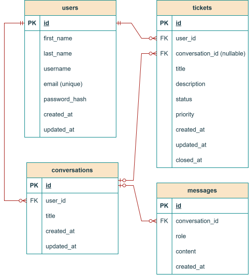
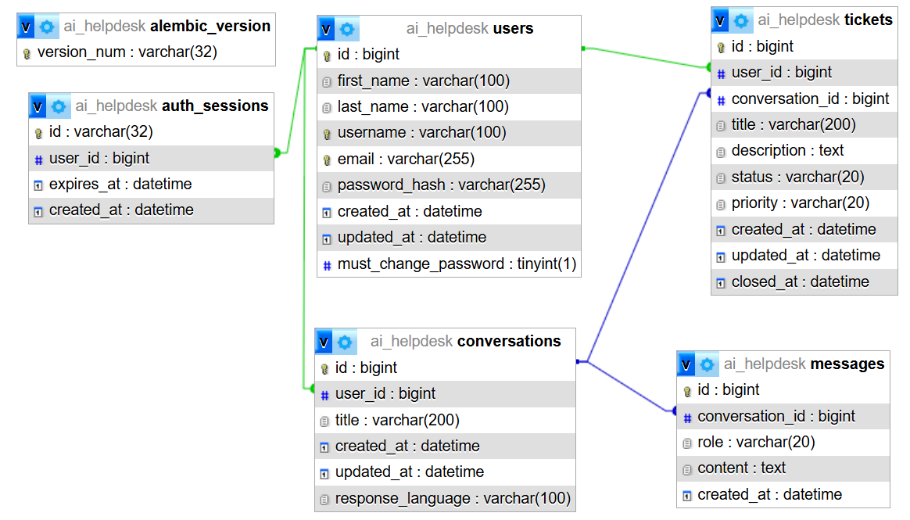

# AI HelpDesk – Järjestelmän suunnittelu

## 1. Johdanto

### 1.1 Dokumentin tarkoitus

Tämä dokumentti kuvaa AI HelpDesk -sovelluksen teknisen suunnittelun. Se määrittelee järjestelmän arkkitehtuurin, tietokannan rakenteen, tietokannan entiteettien väliset suhteet, REST-rajapinnan sekä käyttöliittymän keskeiset näkymät.

Suunnittelun tavoitteena on luoda selkeä ja ylläpidettävä rakenne, joka tukee sovelluksen keskeisiä toimintoja:

- Käyttäjien rekisteröityminen ja kirjautuminen.
- Käyttäjäprofiilin hallinta.
- Tukipyyntöjen luominen ja hallinta.
- Tekoälypohjainen keskustelu.
- Keskusteluviestien pysyvä tallentaminen.
- Tukipyynnön luominen keskustelun perusteella.
- Tietopohjainen tekoälyneuvonta, jossa Knowledge Service hakee keskusteluun liittyvää teknistä dokumentaatiota.
- Suomen- ja englanninkielinen käyttöliittymä.
- Frontendin, backendin, MySQL-tietokannan, Redisin ja Ollama-tekoälypalvelun käynnistäminen Docker Composella yhdellä komennolla.
- Tukipyynnön luominen keskustelusta vasta käyttäjän tarkistuksen ja vahvistuksen jälkeen sekä omien tukipyyntöjen rajattu yhteenveto.

### 1.2 Järjestelmän tavoitteet

AI HelpDesk -sovelluksen tavoitteena on tarjota käyttäjälle yksi palvelu, jossa teknisiä ongelmia voidaan ratkaista tekoälyn avulla ja tarvittaessa siirtää ratkaisemattomat ongelmat tukipyyntöjen käsittelyyn.

Järjestelmän tulee olla:

- **Turvallinen:** käyttäjä voi käsitellä vain tietoja, joihin hänellä on oikeus.
- **Ylläpidettävä:** käyttöliittymä, backend, tietokanta ja tekoälyintegraatio ovat selkeästi erotettuja.
- **Laajennettava:** uusia toimintoja voidaan lisätä ilman koko järjestelmän uudelleensuunnittelua.
- **Luotettava:** virhetilanteet käsitellään hallitusti ja käyttäjälle annetaan ymmärrettävä palaute.
- **Testattava:** keskeisille toiminnoille voidaan toteuttaa yksikkö- ja integraatiotestit.

### 1.3 Käyttäjäroolit

| Rooli | Kuvaus |
|---------|---------|
| Rekisteröitynyt käyttäjä | Hallitsee profiiliaan, keskustelee tekoälyn kanssa ja hallitsee omia tukipyyntöjään. |
| Sovelluksen kehittäjä | Toteuttaa, testaa, ylläpitää ja dokumentoi järjestelmää. |

Kehittäjärooli kuvaa projektin teknistä vastuuta eikä automaattisesti tarkoita erillistä sovelluksen ylläpitäjäroolia.

---

## 2. Järjestelmän arkkitehtuuri

### 2.1 Arkkitehtuurin yleiskuvaus

AI HelpDesk toteutetaan kerroksittaisena web-sovelluksena. Frontend vastaa käyttöliittymästä, backend liiketoimintalogiikasta ja tietoturvatarkistuksista sekä tietokanta pysyvästä tallennuksesta. Tekoälypalvelua käytetään teknisten ongelmien analysointiin ja ratkaisuehdotusten tuottamiseen.


Arkkitehtuurikuva säilyy rakenteeltaan ennallaan. Valitut lisäominaisuudet näkyvät siinä ja toteutuksen rajauksessa seuraavasti:

- **RAG:** Chat Service hyödyntää Knowledge Serviceä, joka hakee avainsanoilla rajatusta Markdown- ja TXT-dokumenttikokoelmasta. Löydetty sisältö ja todelliset lähdetiedot välitetään AI Servicelle ja näytetään vastauksen yhteydessä. Jos sopivaa sisältöä ei löydy, vastausta ei esitetä dokumentaation vahvistamana. Semanttinen haku ei kuulu MVP:hen, ja sitä harkitaan vain testinäytön perusteella.
- **Monikielisyys:** Frontendin käyttöliittymätekstit ovat saatavilla suomeksi ja englanniksi. Kielivalinta säilytetään selaimessa. Backend tunnistaa viestin kielen ja mahdollisen nimenomaisen vastauskielipyynnön ennen vastauksen generointia: tekoäly vastaa suomeksi tai englanniksi viestin kielen mukaan ja muilla kielillä oletusarvoisesti englanniksi. Käyttäjän nimenomainen vastauskielipyyntö tallennetaan keskusteluun ja säilyy, kunnes käyttäjä vaihtaa sitä.
- **Docker Compose:** frontend, backend, MySQL ja Ollama käynnistetään README:ssä dokumentoidulla yhdellä komennolla. Ollama käyttää valittua GGUF-mallia Docker-ympäristössä, eikä AI-palvelun suorittaminen riipu host-koneelle asennetusta Ollamasta.
- **Autentikointi:** rekisteröityminen sekä kirjautuminen ja uloskirjautuminen ovat käytössä. Kirjautumisistunnot tallennetaan MySQL:ään ja kirjautumisyritysten käyttörajat Redisissä.
- **Proxy ja IP-käyttöraja:** kehityksen Compose-ympäristössä frontend käyttää vain erillistä proxy-verkkoa, jonka IP on `172.30.0.2`, ja välittää `/api`-pyynnöt backendille verkkoaliaksella `backend-proxy`. Backend lukee `X-Forwarded-For`-otsakkeen vain, kun suora yhteyden peer-osoite kuuluu `TRUSTED_PROXY_IPS`-asetuksella määritettyyn luotettuun IP-verkkoon. Ketjua käsitellään oikealta vasemmalle; luotetut proxy-hopit ohitetaan ja ensimmäistä luottamatonta osoitetta käytetään asiakkaan IP-osoitteena. Muiden peerien välittämää otsaketta ei käytetä.
- **Toimituslaajuus:** US-09 ja US-14 ovat virallisia käyttäjätarinoita. Tukipyyntö luodaan keskustelusta vain käyttäjän tarkistuksen ja vahvistuksen jälkeen; yhteenveto näyttää vain käyttäjän omat kokonais-, `OPEN`- ja `CLOSED`-määrät.

### 2.2 Frontend

Frontend tarjoaa käyttäjälle visuaalisen käyttöliittymän ja välittää käyttäjän toiminnot backendille REST-rajapinnan kautta.

#### Frontendin vastuut

- Rekisteröitymis- ja kirjautumisnäkymät.
- Käyttäjäprofiilin tarkastelu; käyttäjä voi päivittää vain käyttäjänimensä. Etunimi, sukunimi ja sähköpostiosoite ovat vain luettavissa.
- Salasanan vaihtaminen nykyisen salasanan vahvistuksella.
- Tukipyyntöjen luominen, tarkastelu ja sulkeminen.
- Tekoälykeskustelun näyttäminen.
- Keskusteluhistorian näyttäminen.
- Lomakkeiden syötteiden alustava validointi.
- Onnistumis- ja virheilmoitusten näyttäminen.
- Suomen- ja englanninkielisen käyttöliittymän tukeminen.

Frontend ei vastaa käyttöoikeuksien lopullisesta tarkistamisesta. Kaikki suojattujen tietojen käsittelyä koskevat tarkistukset tehdään backendissä.

### 2.3 Backend

Backend tarjoaa REST-rajapinnan ja toteuttaa sovelluksen liiketoimintalogiikan.

#### Backendin vastuut

- Käyttäjien rekisteröityminen ja kirjautuminen.
- Autentikointi ja käyttöoikeuksien tarkistaminen.
- Pyyntöjen validointi.
- Tukipyyntöjen ja keskusteluviestien käsittely.
- Tietojen lukeminen ja tallentaminen tietokantaan.
- Tekoälypalvelun kutsuminen ja vastausten käsittely.
- Virhetilanteiden hallinta.
- Rajapinnan yhtenäisten HTTP-vastausten palauttaminen.

#### Backendin loogiset komponentit

| Komponentti | Vastuu |
|------------|---------|
| Auth Service | Käyttäjän tunnistaminen ja käyttöoikeudet |
| User Service | Profiilitietojen hallinta ja salasanan vaihtamisen orkestrointi |
| Auth Service | Nykyisen salasanan tarkistaminen ja salasanan tiivisteen turvallinen päivittäminen |
| Admin Password Reset | Ylläpitäjän backend-komennon käyttöoikeus, väliaikaisen salasanan luonti, pakotetun vaihdon merkitseminen ja istuntojen mitätöinti |
| Ticket Service | Tukipyyntöjen luominen ja päivittäminen |
| Chat Service | Keskustelujen ja viestien käsittely |
| AI Service | Tekoälypalvelun integraatio |
| Knowledge Service | Teknisen dokumentaation haku RAG-vastauksia varten |

Nämä ovat loogisia komponentteja, eivät välttämättä erillisiä palvelimia tai mikropalveluita.

### 2.4 Tietokanta

Järjestelmän ensisijaisena relaatiotietokantana käytetään MySQL-tietokantaa.

Tietokanta tallentaa:

- Käyttäjien tiedot.
- Aktiiviset kirjautumisistunnot ja niiden voimassaoloajat.
- Tukipyynnöt ja niiden tilat.
- Keskustelut.
- Keskusteluviestit.
- Tarvittavat luonti- ja päivitysajat.

Tietokannan viite-eheys varmistetaan pää- ja viiteavaimilla. Käyttäjäkohtaisissa hauissa käytetään tunnistetun käyttäjän omistajuuteen perustuvia suodatuksia.

### 2.5 Tekoälyintegraatio

AI Service välittää käyttäjän viestin Compose-ympäristössä toimivalle Ollama-palvelulle ja käsittelee saadun vastauksen. Oletusmalli on `poro-helpdesk`, joka luodaan GGUF-tiedostosta `Llama-Poro-2-8B-Instruct.Q4_K_M.gguf` [Modelfile](../../ollama/Modelfile)-tiedoston avulla. Mallin nimi ja alustuslähde määritetään asetuksilla `OLLAMA_MODEL` ja `OLLAMA_MODEL_SOURCE`: `registry` hakee mallin Ollama-rekisteristä, kun taas `modelfile` luo mallin paikallisesta Modelfile-tiedostosta. Nykyinen oletus-Modelfile asettaa kontekstipituudeksi 8192 ja lämpötilaksi 0.2.

#### Tekoälyintegraation tulee

- Kutsua Ollamaa backendistä Compose-verkon sisäisellä palvelunimellä ja rajapinnalla; selain ei kutsu Ollamaa suoraan.
- Käynnistää Ollama Compose-palveluna ja varmistaa terveystarkistuksella, että palvelu sekä valittu malli ovat käytettävissä.
- Kun `OLLAMA_MODEL_SOURCE=modelfile`, tuoda valittu GGUF-tiedosto paikalliseen `ollama/models/`-hakemistoon. Compose liittää `ollama/`-hakemiston vain luku -tilassa polkuun `/models`, ja oletus-Modelfile käyttää konttipolkua `/models/models/Llama-Poro-2-8B-Instruct.Q4_K_M.gguf`.
- Alustaa Compose-käynnistyksessä asetuksilla valittu malli joko Modelfile-tiedostosta luomalla tai Ollama-rekisteristä hakemalla; jo pysyvässä Ollama-varastossa olevaa mallia ei alusteta uudelleen.
- Ladata malli backendin käynnistyessä Ollaman muistivapaalla preload-pyynnöllä ja pyytää Ollamaa pitämään se muistissa 24 tuntia käyttämättömänä; backendin käynnistys odottaa preloadin onnistumista.
- Säilyttää Ollaman mallivaraston pysyvässä Docker-volyymissa, jotta palvelun uudelleenkäynnistys ei edellytä mallin uutta manuaalista tuontia.
- Käsitellä aikakatkaisut, palveluvirheet ja käyttörajoitukset.
- Rajoittaa tekoälylle lähetettävän keskustelukontekstin määrää.
- Vastata suomeksi tai englanniksi käyttäjän viestin kielen perusteella, käyttää muilla kielillä oletusarvoisesti englantia sekä säilyttää käyttäjän nimenomaisesti pyytämän muun vastauskielen keskustelun tietokannassa.
- Tallentaa keskusteluviestit sovelluksen määrittelemien tallennuskäytäntöjen mukaisesti.
- Sarjoittaa saman keskustelun AI-vuorot Redis-lukolla, vapauttaa tietokantayhteyden Ollama-kutsun ajaksi ja tallentaa assistant-vastauksen lyhyessä erillisessä tietokantaistunnossa.
- Mahdollistaa jo tallennetun käyttäjäviestin vastauksen uudelleenyrityksen ilman käyttäjäviestin kaksoistallennusta; virheellisesti muotoiltu Ollama-vastaus käsitellään palveluvirheenä.
- Välttää tarpeettomien henkilötietojen lähettämistä mallille.

Tekoälyn tuottamat vastaukset ovat ehdotuksia. Niiden oikeellisuutta ei voida taata kaikissa tilanteissa.

### 2.6 RAG MVP ja tietolähteet

Knowledge Service käsittelee ennen toteutusta ryhmän rajaamaa, käyttöön hyväksyttyä Markdown- ja TXT-dokumenttikokoelmaa. Tarkka lähdekokoelma ja sen ylläpitopaikka vahvistetaan ennen toteutusta; dokumentteja ei haeta ennalta määrittelemättömistä tai ulkoisista lähteistä.

MVP:n hakutapa on avainsanahaku. Palvelu hakee kysymykseen sopivia dokumenttikohtia, välittää löydetyt tekstikatkelmat ja lähdetiedot Chat Servicen kautta AI Servicelle sekä palauttaa lähdetiedot käyttöliittymän näytettäväksi. Hakutuloksen lähdetieto perustuu todelliseen tiedostoon ja löydettyyn kohtaan. Jos sopivaa kohtaa ei löydy, mallille ei anneta keksittyä lähdettä eikä vastausta esitetä dokumentaation vahvistamana.

Avainsanahaun laatua arvioidaan ennen toteutusta määritellyillä kysymyksillä ja dokumenteilla, mukaan lukien relevantin osuman ja osumattoman kyselyn testit. Semanttinen haku tai vektoritietokanta lisätään vasta, jos testitulokset osoittavat avainsanahaun riittämättömäksi ja muutos hyväksytään. RAG MVP:n dokumenttikokoelma ja hakutapa eivät edellytä ER-kaavion tai MySQL-skeeman muuttamista. Jos myöhemmin syntyy todellinen pysyvän uuden datan tarve, tietomalli ja ER-kaavio päivitetään erikseen muutoksenhallinnassa.

Malli, Ollama, Docker-kuvat ja muut työkalut sekä kirjastot tarkistetaan maksuttomuuden, lisenssien ja käyttöehtojen osalta ennen toimitusta. Mahdollisia lisenssiehtoja ei oleteta täytetyiksi ilman tarkistusta.

---

## 3. ER-diagrammi

### 3.1 Entiteetit ja niiden suhteet

Järjestelmän keskeiset entiteetit ovat User, Ticket, Conversation ja Message.



Kaavio on ylläpidetty muuttamattomana yleiskuvana tietokantatauluista ja niiden suhteista. Alla olevat taulukot täsmentävät kenttien nimet ja rajoitteet. Ne sisältävät myös `tickets.created_at`- ja `tickets.updated_at`-kentät, `conversations.created_at`- ja `conversations.updated_at`-kentät sekä `messages.created_at`-kentän, joita ei ole merkitty kaavioon. Tukipyynnön luontiaika vaaditaan FR-05:n täyttämiseksi; muut aikaleimat tukevat historian näyttämistä ja tietojen ylläpitoa.

**Päivitetty tietokanta** (11/11/2026)

Olen lisännyt projektiini joitakin ominaisuuksia, joten myös nykyistä tietokantaani täytyi päivittää alla olevalla tavalla.



### 3.2 Entiteettien kuvaukset

#### User

Sisältää käyttäjän tunnistamiseen ja profiiliin liittyvät tiedot. Sähköpostiosoite on yksilöllinen, ja salasana tallennetaan vain turvallisesti tiivistettynä.

#### Ticket

Sisältää tukipyynnön otsikon, kuvauksen, tilan, prioriteetin ja omistajan. Jokainen tukipyyntö kuuluu yhdelle käyttäjälle.

#### Conversation

Edustaa yhtä käyttäjän keskustelukokonaisuutta. Keskustelu kuuluu yhdelle käyttäjälle ja voi sisältää useita viestejä.

#### Message

Sisältää keskusteluun liittyvän yksittäisen viestin. Viestin rooli kertoo, onko kyse käyttäjän viestistä vai tekoälyn vastauksesta.

### 3.3 Kardinaliteetit

| Suhde | Kardinaliteetti | Kuvaus |
|---------|---------|---------|
| User – Ticket | User 1 → 0..N Ticket; Ticket 1 → 1 User | Käyttäjällä voi olla nolla tai useita tukipyyntöjä; jokaisella tukipyynnöllä on yksi omistaja. |
| User – Conversation | User 1 → 0..N Conversation; Conversation 1 → 1 User | Käyttäjällä voi olla nolla tai useita keskusteluja; jokainen keskustelu kuuluu yhdelle käyttäjälle. |
| Conversation – Ticket | Conversation 1 → 0..N Ticket; Ticket 0..1 → 1 Conversation | Keskustelusta voidaan luoda useita tukipyyntöjä; tukipyyntö voi olla itsenäinen tai liittyä yhteen keskusteluun. |
| Conversation – Message | Conversation 1 → 0..N Message; Message 1 → 1 Conversation | Keskustelussa voi olla nolla tai useita viestejä; jokainen viesti kuuluu yhteen keskusteluun. |
| Conversation – Conversation (emo/lapsi) | Parent 1 → 0..N Child; Child 0..1 → 1 Parent | Keskustelu voi olla itsenäinen (ei emokeskustelua) tai yhden keskustelun lapsi. Emokeskustelulla voi olla useita lapsia; vierasavain sallii NULL-arvon ja käyttää ON DELETE SET NULL -toimintoa. |

ER-diagrammi säilyy yleiskuvana eikä esitä Conversation-taulun itseensä viittaavaa emo/lapsi-suhdetta. Kardinaliteettitaulukko ja alla olevat yksityiskohtaiset kenttämäärittelyt ovat tämän suhteen auktoritatiivinen kuvaus. RAG MVP käyttää tiedostopohjaista Markdown- ja TXT-dokumenttikokoelmaa avainsanahakuun eikä lisää tietokantaan dokumentti- tai hakutauluja. ER-skeemaa muutetaan vain, jos toteutuksessa syntyy erikseen perusteltu pysyvän uuden datan tarve.

---

## 4. Tietokannan suunnittelu

## 4.1 Yleiset tietokantaperiaatteet

1. Taulujen ensisijaiset avaimet ovat yksilöllisiä.
2. Viiteavaimet varmistavat taulujen väliset suhteet.
3. Sähköpostiosoitteelle asetetaan yksilöllisyysrajoite.
4. Pakolliset kentät määritellään `NOT NULL` -rajoitteilla.
5. Aikaleimat tallennetaan yhdenmukaisesti sovitulla aikavyöhykekäytännöllä, esimerkiksi UTC-ajassa.
6. Käyttäjien salasanat tallennetaan vahvalla salasanatiivisteellä.
7. Käyttäjän tiedot voidaan hakea sähköpostiosoitteen ja pääavaimen avulla.
8. Tukipyynnöt ja keskustelut haetaan käyttäjäkohtaisesti.
9. Tietokantayhteydet käyttävät parametrisoituja kyselyitä.

## 4.2 Taulu: users

| Sarake | Tietotyyppi | Rajoitteet | Kuvaus |
|----------|------------|------------|---------|
| id | BIGINT | PK, AUTO_INCREMENT | Käyttäjän tunniste |
| first_name | VARCHAR(100) | NOT NULL | Käyttäjän etunimi |
| last_name | VARCHAR(100) | NOT NULL | Käyttäjän sukunimi |
| username | VARCHAR(100) | NOT NULL, UNIQUE | Käyttäjänimi |
| email | VARCHAR(255) | NOT NULL, UNIQUE | Sähköpostiosoite |
| password_hash | VARCHAR(255) | NOT NULL | Salasanan tiiviste |
| must_change_password | BOOLEAN | NOT NULL, DEFAULT FALSE | Pakottaa salasanan vaihtamisen seuraavan kirjautumisen jälkeen |
| created_at | DATETIME | NOT NULL | Luontiaika |
| updated_at | DATETIME | NOT NULL | Viimeisin päivitysaika |

Kirjautumisistunnot tallennetaan lisäksi tekniseen `auth_sessions`-tauluun. Taulussa on istunnon satunnainen tunniste, käyttäjän viiteavain sekä luonti- ja vanhenemisajat. Uloskirjautuminen poistaa kyseisen istunnon, jolloin myös kopioitu istuntoeväste lakkaa toimimasta. Tämä tekninen taulu ei kuulu nykyiseen käsitteelliseen ER-kaavioon.

## 4.3 Taulu: tickets

| Sarake | Tietotyyppi | Rajoitteet | Kuvaus |
|----------|------------|------------|---------|
| id | BIGINT | PK, AUTO_INCREMENT | Tukipyynnön tunniste |
| user_id | BIGINT | FK, NOT NULL | Tukipyynnön omistaja |
| conversation_id | BIGINT | FK, NULL | Tukipyynnön lähdekeskustelu, jos pyyntö luotiin keskustelusta |
| title | VARCHAR(200) | NOT NULL | Tukipyynnön otsikko |
| description | TEXT | NOT NULL | Ongelman kuvaus |
| status | VARCHAR(20) | NOT NULL | Tukipyynnön tila |
| priority | VARCHAR(20) | NOT NULL | Tukipyynnön prioriteetti |
| created_at | DATETIME | NOT NULL | Luontiaika |
| updated_at | DATETIME | NOT NULL | Viimeisin päivitysaika |
| closed_at | DATETIME | NULL | Sulkemisaika |

MVP:n tukipyynnön tilat ovat:

- `OPEN`
- `CLOSED`

`IN_PROGRESS` voidaan ottaa käyttöön myöhemmin, kun tukipalvelun käsittelyrooli ja tilan muutossäännöt määritellään.

Prioriteetit voivat olla:

- `LOW`
- `MEDIUM`
- `HIGH`

Sallitut arvot validoidaan backendissä ja tarvittaessa tietokannan rajoitteilla.

## 4.4 Taulu: conversations

| Sarake | Tietotyyppi | Rajoitteet | Kuvaus |
|----------|------------|------------|---------|
| id | BIGINT | PK, AUTO_INCREMENT | Keskustelun tunniste |
| user_id | BIGINT | FK, NOT NULL | Keskustelun omistaja |
| title | VARCHAR(200) | NULL | Keskustelun otsikko |
| created_at | DATETIME | NOT NULL | Luontiaika |
| updated_at | DATETIME | NOT NULL | Viimeisin päivitysaika |

Keskustelun otsikko voidaan määritellä käyttäjän ensimmäisen viestin perusteella tai antaa käyttäjän muokattavaksi myöhemmässä versiossa.

## 4.5 Taulu: messages

| Sarake | Tietotyyppi | Rajoitteet | Kuvaus |
|----------|------------|------------|---------|
| id | BIGINT | PK, AUTO_INCREMENT | Viestin tunniste |
| conversation_id | BIGINT | FK, NOT NULL | Viestin keskustelu |
| role | VARCHAR(20) | NOT NULL | Viestin lähettäjän rooli |
| content | TEXT | NOT NULL | Viestin sisältö |
| created_at | DATETIME | NOT NULL | Viestin luontiaika |

Viestin `role` voi olla esimerkiksi:

- `USER`
- `ASSISTANT`

Järjestelmän sisäisiä ohjeita tai työkaluviestejä varten tarvitaan erillinen, tarkemmin määritelty käsittely, jos sellaisia tallennetaan.

## 4.6 Indeksit ja viite-eheys

### Suositellut indeksit

| Taulu | Indeksi | Tarkoitus |
|---------|---------|---------|
| users | UNIQUE(email) | Nopeuttaa kirjautumista ja estää päällekkäiset sähköpostiosoitteet |
| tickets | INDEX(user_id, created_at) | Käyttäjän tukipyyntöjen hakeminen |
| tickets | INDEX(user_id, status) | Tukipyyntöjen haku tilan perusteella |
| tickets | INDEX(conversation_id) | Keskusteluun liittyvien tukipyyntöjen hakeminen |
| tickets | INDEX(status, closed_at) | Suljettujen tukipyyntöjen säilytyssiivous |
| conversations | INDEX(user_id, updated_at) | Käyttäjän keskusteluhistorian hakeminen |
| conversations | INDEX(updated_at) | Passiivisten keskustelujen säilytyssiivous |
| messages | INDEX(conversation_id, created_at, id) | Keskusteluviestien hakeminen järjestyksessä |

Viiteavaimille määritellään tietojen poistamiseen ja päivittämiseen sopivat säännöt. Esimerkiksi käyttäjän poistamista ei tule toteuttaa siten, että siihen liittyvät tiedot jäävät tietokantaan hallitsemattomasti.

### Tietojen säilytys ja siivous

Backend suorittaa päivittäin erissä (enintään 500 tunnistetta kerrallaan) automaattisen siivouksen. Aikaraja on kolme kalenterikuukautta, ei kiinteä 90 päivän jakso:

- `CLOSED`-tukipyyntö poistetaan pysyvästi, kun `closed_at` on aikarajalla tai sitä vanhempi.
- Keskustelu poistetaan pysyvästi, kun `updated_at` on aikarajalla tai sitä vanhempi.
- Keskustelua ei poisteta, jos siihen liittyy avoin tukipyyntö tai suljettu tukipyyntö, jonka `closed_at` ei ole vielä saavuttanut säilytysrajaa.
- Keskustelun viestit poistuvat viiteavaimen `ON DELETE CASCADE` -säännön mukaisesti. Tukipyynnön viite keskusteluun on `ON DELETE SET NULL`.

Siivous suoritetaan FastAPI:n elinkaaren taustatehtävässä tietokantatyössä, ja tietokantavirhe kirjataan lokiin sekä yritetään uudelleen seuraavalla päivittäisellä jaksolla. Siivousindeksit lisätään Alembic-migraatiolla `0005_data_retention_indexes`. Poisto on peruuttamaton; tietokannan varmuuskopiointi ja sovellettavat tietosuojakäytännöt ovat ylläpidon vastuulla.

Siivous valitsee eräehdokkaat ilman pitkää lukitsevaa aluehakua ja toistaa voimassaoloehdot varsinaisessa `DELETE`-komennossa. Keskustelun poisto lukitsee poistettavan rivin; chatin lähetys ja retry lukitsevat keskustelurivin ennen viestin tallennusta. Näin rinnakkaisen chat-päivityksen jälkeen `DELETE` arvioi aikaleiman uudelleen eikä poista aktivoitua keskustelua. Vierasavaimen lukitus synkronoi keskustelun poiston siihen liittyvän uuden tukipyynnön luonnin kanssa.

Kun tukipyyntö luodaan keskustelusta, `tickets.conversation_id` viittaa lähdekeskusteluun. Backend varmistaa, että keskustelu kuuluu samalle kirjautuneelle käyttäjälle kuin tukipyyntö. Itsenäisesti luodun tukipyynnön `conversation_id` on `NULL`.

## 4.7 Tietojen tallennuksen transaktiot

Tietokantaan liittyvät toiminnot toteutetaan tarvittaessa transaktioina.

Esimerkiksi tukipyynnön luomisessa järjestelmä:

1. Validoi käyttäjän lähettämät tiedot.
2. Tarkistaa käyttäjän tunnistamisen ja oikeudet.
3. Tallentaa tukipyynnön tietokantaan.
4. Palauttaa luodun tukipyynnön tunnisteen ja tiedot.

Keskusteluviestin tallennuksessa käyttäjän viesti ja tekoälyn vastaus käsitellään erillisinä tallennettavina tapahtumina. Saman keskustelun samanaikaiset AI-vuorot sarjoitetaan Redis-lukolla, eikä uutta viestiä hyväksytä, jos viimeinen käyttäjäviesti odottaa vielä vastausta. Käyttäjäviesti tallennetaan ennen Ollama-kutsua; historian lukemisen jälkeen SQLAlchemy-transaktio suljetaan ennen AI-palvelun odottamista. Assistant-vastaus tallennetaan lyhytkestoisessa erillisessä tietokantaistunnossa. AI-virhe ei tuota keksittyä vastausta: tallennetun viestin vastausta voi yrittää uudelleen erillisellä retry-reitillä ilman uuden käyttäjäviestin kaksoistallennusta.

---

## 5. REST API -suunnittelu

## 5.1 Yleiset periaatteet

REST API toimii frontendin ja backendin välisenä rajapintana.

### Rajapinnan periaatteet

1. Käytetään HTTP-protokollaa ja JSON-muotoista tiedonsiirtoa.
2. Käytetään resurssipohjaisia URL-osoitteita.
3. Suojatut endpointit edellyttävät autentikointia.
4. Backend validoi kaikki asiakkaalta tulevat tiedot.
5. Käyttäjän omistajuus ja käyttöoikeudet tarkistetaan jokaisessa suojatussa resurssipyynnössä.
6. Virhetilanteissa palautetaan tarkoituksenmukainen HTTP-statuskoodi.
7. Rajapinnan versio voidaan sisällyttää osoitteeseen, esimerkiksi `/api/v1`.
8. Istuntoevästeitä käyttävä selain lähettää pyyntöihin tunnistetiedot; backend sallii tunnistetiedot sisältävän CORS-pyynnön vain määritellystä frontend-alkuperästä eikä käytä tunnistetietojen kanssa yleistä `*`-alkuperää.

## 5.2 Endpointit

Autentikointi-, profiili-, tukipyyntö- ja keskustelureitit on toteutettu. RAG-hakureitti on suunniteltu, eikä sitä pidä merkitä valmiiksi ennen Sprint 5:n toteutusta.

### Autentikointi ja käyttäjätili

| HTTP-metodi | Endpoint | Kuvaus | Autentikointi |
|------------|----------|---------|--------------|
| POST | `/api/v1/auth/register` | Luo käyttäjätilin | Ei |
| POST | `/api/v1/auth/login` | Kirjaa käyttäjän sisään | Ei |
| POST | `/api/v1/auth/logout` | Kirjaa käyttäjän ulos ja mitätöi nykyisen istunnon, jos eväste on voimassa | Istuntoeväste |
| GET | `/api/v1/auth/me` | Palauttaa kirjautumistilan ja mahdollisen pakotetun salasananvaihdon tilan | Istuntoeväste |
| GET | `/api/v1/users/me` | Hakee kirjautuneen käyttäjän profiilin ilman salasanatiivistettä | Toteutettu (US-03) |
| PATCH | `/api/v1/users/me` | Päivittää vain käyttäjänimen; etunimeä, sukunimeä tai sähköpostia ei voi muuttaa | Toteutettu (US-03) |
| POST | `/api/v1/users/me/password` | Vaihtaa salasanan nykyisen salasanan ja uuden salasanan vahvistuksen jälkeen; tallentaa vain tiivisteen ja mitätöi käyttäjän aktiiviset istunnot | Toteutettu (US-03) |

#### Ylläpidon toteuttama unohtuneen salasanan palautus (US-17)

US-17 toteutetaan vain backendin ylläpitokomennolla. Se ei lisää julkista HTTP-reset-endpointia, salasanan palautusnäkymää, sähköpostiviestiä, OTP-koodia eikä sovelluksen ADMIN-käyttöliittymää. Tässä määrittelyssä ADMIN tarkoittaa ylläpitotoimintoon valtuutettua henkilöä, joka on varmistanut käyttäjän henkilöllisyyden sovelluksen ulkopuolella. Oikeus komentoon perustuu backend-ympäristön käyttöoikeuksiin, ei tavallisen käyttäjän istuntoon tai asiakkaan lähettämään roolikenttään.

**Ylläpitokomennon toimintaketju**

1. Ylläpitäjä suorittaa komennon backend-kontin tai muun suojatun backend-ylläpitoympäristön kautta. Komento hyväksyy yksilöivän käyttäjätunnisteen, ensisijaisesti sähköpostiosoitteen; käyttäjän olemassaolo tarkistetaan ennen muutoksia.
2. Komento luo kryptografisesti turvallisella satunnaislukugeneraattorilla väliaikaisen salasanan. Salasanan tulee täyttää sama palvelinpuolen salasanapolitiikka kuin tavallisen salasanan.
3. Komento tiivistää väliaikaisen salasanan nykyisellä salasanatiivistefunktiolla ja tallentaa vain tiivisteen users.password_hash-kenttään.
4. Samassa tietokantatransaktiossa komento asettaa users.must_change_password = TRUE ja poistaa kaikki käyttäjän auth_sessions-rivit. Salasanan vaihto, pakotetun vaihdon merkintä ja istuntojen mitätöinti joko onnistuvat yhdessä tai peruuntuvat yhdessä.
5. Väliaikainen salasana tulostetaan ylläpitokomennon onnistuneessa tulosteessa täsmälleen kerran. Sitä ei tallenneta tietokantaan selväkielisenä, tiedostoon, komentohistoriaan, sovelluslokeihin tai virheilmoituksiin. Komento ei tulosta salasanaa, jos transaktio epäonnistuu.
6. Ylläpitäjä toimittaa väliaikaisen salasanan käyttäjälle turvallista, sovelluksen ulkopuolista kanavaa pitkin. Käyttäjän on vaihdettava se heti kirjautumisen jälkeen.

**Kirjautuminen ja pakotettu salasanan vaihto**

- Onnistunut kirjautuminen käyttäjän väliaikaisella salasanalla luo normaalin palvelinpuolen istunnon, mutta asettaa istunnon rajoitettuun tilaan käyttäjän must_change_password-arvon perusteella.
- Rajoitetulla istunnolla sallitaan vain salasanan vaihtaminen ja uloskirjautuminen. Kaikki muut suojatut API-pyynnöt estetään backendissä HTTP 403 -vastauksella riippumatta siitä, kutsutaanko niitä suoraan API:sta vai käyttöliittymän kautta.
- Rajoitus toteutetaan keskitetysti autentikoinnin/suojattujen endpointien yhteisessä riippuvuudessa tai käyttöoikeustarkistuksessa. Yksittäisen frontend-näkymän piilottaminen ei täytä vaatimusta.
- GET /api/v1/auth/me saa palauttaa vain kirjautumisen tilan ja tiedon siitä, että salasanan vaihto vaaditaan; se ei saa avata muita käyttäjätietoja tai suojattuja toimintoja. POST /api/v1/auth/logout pysyy sallittuna.
- Salasanan vaihtamisen endpoint tarkistaa uuden salasanan ja vahvistuksen palvelinpuolella, tallentaa uuden tiivisteen ja asettaa must_change_password = FALSE. Vaihdon yhteydessä vanha istunto mitätöidään ja käyttäjä kirjataan ulos; käyttäjän on kirjauduttava uudelleen uudella salasanalla.
- Tavallisen käyttäjän pyyntö ei voi asettaa tai poistaa must_change_password-arvoa eikä kutsua ylläpitokomentoa.

**Transaktiot, virheet ja lokitus**

- Käyttäjän haku, salasanatiivisteen päivitys, pakotetun vaihdon merkintä ja kaikkien istuntojen poisto tehdään yhtenä transaktiona. Käyttäjärivi lukitaan päivityksen ajaksi, jotta samanaikainen kirjautuminen ei voi jättää voimaan vanhalla salasanalla luotua istuntoa.
- Tuntemattomasta käyttäjästä annetaan ylläpitäjälle selkeä virhe, mutta selväkielistä salasanaa ei tulosteta eikä mitään tietoja muuteta.
- Komento palauttaa ei-nollan poistumiskoodin epäonnistuessaan. Väliaikainen salasana näytetään vain onnistuneen commitin jälkeen.
- Lokeihin saa kirjata komennon suorittamisen ajankohdan, kohdekäyttäjän sisäisen tunnisteen ja onnistumis-/epäonnistumistiedon vain siinä laajuudessa kuin ylläpidon auditointi edellyttää. Salasanaa, sen tiivistettä, istuntotunnisteita tai evästeitä ei kirjata.
- Ylläpitoympäristön käyttöoikeudet ja terminaalin tulosteen käsittely ovat ylläpitäjän vastuulla. Väliaikainen salasana on kertakäyttöinen toimitustieto, eikä sitä pidä jättää jaettuihin lokeihin tai tallenteisiin.

**Toteutuksen tila:** ylläpitokomento on toteutettu moduulissa `app.admin`, ja käyttöohje on README:ssä. Pakotetun salasanan vaihdon backend-rajoitus, istuntojen mitätöinti ja `must_change_password`-skeema ovat käytössä. Komennon suoritus edellyttää suojatun backend-/Docker-ympäristön käyttöoikeutta; sovelluksessa ei ole ADMIN-käyttöliittymää.
### Tukipyynnöt

| HTTP-metodi | Endpoint | Kuvaus | Autentikointi |
|------------|----------|---------|--------------|
| GET | `/api/v1/tickets` | Hakee kirjautuneen käyttäjän tukipyynnöt | Kyllä |
| POST | `/api/v1/tickets` | Luo uuden tukipyynnön | Kyllä |
| GET | `/api/v1/tickets/summary` | Hakee käyttäjän tukipyyntöjen yhteenvedon | Kyllä |
| GET | `/api/v1/tickets/{id}` | Hakee yksittäisen tukipyynnön | Kyllä |
| PATCH | `/api/v1/tickets/{id}` | Päivittää avoimen tukipyynnön otsikon, kuvauksen tai prioriteetin | Kyllä |
| POST | `/api/v1/tickets/{id}/close` | Sulkee tukipyynnön | Kyllä |

Staattinen `/summary`-reitti määritellään ennen dynaamista `{id}`-reittiä, jotta reititin ei tulkitse sanaa `summary` tukipyynnön tunnisteeksi.

### Keskustelut ja viestit

| HTTP-metodi | Endpoint | Kuvaus | Autentikointi |
|------------|----------|---------|--------------|
| GET | `/api/v1/conversations` | Hakee käyttäjän keskustelut | Kyllä |
| POST | `/api/v1/conversations` | Luo uuden keskustelun | Kyllä |
| GET | `/api/v1/conversations/{id}` | Hakee keskustelun tiedot | Kyllä |
| GET | `/api/v1/conversations/{id}/messages` | Hakee keskustelun viestit | Kyllä |
| POST | `/api/v1/conversations/{id}/messages` | Tallentaa käyttäjäviestin ja pyytää tekoälyvastausta; chat-pyynnön `Origin` tarkistetaan allowlististä | Kyllä |
| POST | `/api/v1/conversations/{id}/messages/{message_id}/retry` | Yrittää luoda vastauksen jo tallennetulle vastaamattomalle käyttäjäviestille | Kyllä |

### Tietopohjainen tekoälyneuvonta

| HTTP-metodi | Endpoint | Kuvaus | Autentikointi |
|------------|----------|---------|--------------|
| POST | `/api/v1/knowledge/search` | Hakee avainsanoilla Markdown- ja TXT-dokumenteista ja palauttaa osuman lähdetiedot | Kyllä |

### Rekisteröityminen

```http
POST /api/v1/auth/register
```

```json
{
  "first_name": "Example",
  "last_name": "User",
  "username": "exampleuser",
  "email": "user@example.com",
  "password": "example-password"
}
```

Onnistunut rekisteröityminen palauttaa HTTP 201 -vastauksen. Vastaus ei sisällä salasanaa eikä sen tiivistettä.

```json
{
  "user": {
    "id": 12,
    "first_name": "Example",
    "last_name": "User",
    "username": "exampleuser",
    "email": "user@example.com"
  }
}
```

## 5.3 Esimerkkipyyntö: kirjautuminen

### Request

```http
POST /api/v1/auth/login
```

```json
{
  "email": "user@example.com",
  "password": "example-password"
}
```

### Response

```json
{
  "must_change_password": false
}
```

Onnistunut kirjautuminen palauttaa HTTP 200 -vastauksen, `Set-Cookie`-otsakkeen ja `must_change_password`-tilan. Virheelliset tunnukset palauttavat yleisen HTTP 401 -vastauksen; käyttörajan ylitys palauttaa HTTP 429 -vastauksen. `GET /api/v1/auth/me` palauttaa autentikoinnin tilan, ei käyttäjän profiilia. Profiilitiedot haetaan erillisestä `/api/v1/users/me`-reitistä.

## 5.4 Esimerkkipyyntö: tukipyynnön luominen

### Request

```http
POST /api/v1/tickets
```

```json
{
  "title": "Cannot connect to the network",
  "description": "The computer cannot connect to the office network."
}
```

### Response

```json
{
  "id": 101,
  "title": "Cannot connect to the network",
  "description": "The computer cannot connect to the office network.",
  "status": "OPEN",
  "priority": "MEDIUM",
  "created_at": "2026-10-22T14:00:00Z"
}
```

Backend johtaa omistajan kirjautuneesta istunnosta, asettaa uuden pyynnön tilaksi `OPEN` ja käyttää puuttuvalle prioriteetille oletusta `MEDIUM`. Asiakas ei voi asettaa omistajaa, alkuperäistä tilaa tai aikaleimoja. Jos pyyntö luodaan keskustelusta, backend tarkistaa keskustelun omistajuuden ja tallentaa sen tunnisteen `conversation_id`-kenttään.

MVP-versiossa käyttäjä voi sulkea oman avoimen tukipyyntönsä erillisellä `/close`-toiminnolla. Tällöin backend asettaa tilaksi `CLOSED` sekä päivittää `closed_at`- ja `updated_at`-aikaleimat. `PATCH` sallii vain otsikon, kuvauksen ja prioriteetin päivittämisen avoimessa pyynnössä; se ei salli tilan, omistajan, tunnisteiden tai aikaleimojen muuttamista. `IN_PROGRESS` varataan myöhempään laajennukseen, jossa tukipalvelurooli tai muu määritelty käsittelyprosessi muuttaa tilaa.

## 5.5 Esimerkkipyyntö: keskusteluviestin lähettäminen

### Request

```http
POST /api/v1/conversations/25/messages
```

```json
{
  "content": "My application crashes when I open it."
}
```

### Response

```json
{
  "message": {
    "id": 501,
    "role": "USER",
    "content": "My application crashes when I open it."
  },
  "assistant_message": {
    "id": 502,
    "role": "ASSISTANT",
    "content": "Which operating system and application version are you using?"
  }
}
```

## 5.6 HTTP-statuskoodit

| Statuskoodi | Merkitys | Käyttötapaus |
|-------------|-----------|-------------|
| 200 OK | Pyyntö onnistui | Tietojen haku tai päivitys |
| 201 Created | Resurssi luotiin | Käyttäjä, tukipyyntö tai keskustelu |
| 204 No Content | Toiminto onnistui ilman vastaussisältöä | Uloskirjautuminen |
| 400 Bad Request | Pyyntö on virheellinen | Virheellinen pyyntörakenne |
| 401 Unauthorized | Käyttäjä ei ole tunnistautunut | Puuttuva tai virheellinen autentikointi |
| 403 Forbidden | Toiminto ei ole sallittu | Käyttäjällä ei ole tarvittavia oikeuksia |
| 404 Not Found | Resurssia ei löydy | Tuntematon resurssi |
| 409 Conflict | Tietojen välillä on ristiriita | Käytössä oleva sähköpostiosoite |
| 422 Unprocessable Content | Validointi epäonnistui | Virheelliset kenttäarvot |
| 429 Too Many Requests | Pyyntöjä on liikaa | Rate limiting |
| 500 Internal Server Error | Odottamaton palvelinvirhe | Käsittelemätön virhe |
| 503 Service Unavailable | Palvelu ei ole käytettävissä | Tekoälypalvelun tai Redis-palvelun virhe |

## 5.7 Rajapinnan tietoturva

1. Salasanat tiivistetään turvallisella salasanatiivistealgoritmilla.
2. ADMINin palautuskomento on käytettävissä vain backendin ylläpitoympäristössä; väliaikainen salasana näytetään kerran, pakotettu vaihto estää muut suojatut toiminnot ja kaikki aiemmat istunnot mitätöidään.
3. Autentikointi toteutetaan turvallisella istuntomekanismilla.
4. HTTPS on pakollinen tuotantoympäristössä.
5. Backend tarkistaa käyttäjän oikeudet ennen resurssien palauttamista tai muuttamista.
6. Syötteet validoidaan palvelinpuolella.
7. Tietokantakyselyissä käytetään parametrisoituja kyselyitä.
8. Kirjautumisyrityksiä rajoitetaan Redisissä asiakkaan IP-osoitteen ja normalisoidun sähköpostiosoitteen perusteella; raja palauttaa HTTP 429 -vastauksen ja `Retry-After`-otsakkeen. IP-osoite otetaan välitetystä otsakkeesta vain suoraan yhdistetyn, erikseen luotetuksi määritetyn proxyn tapauksessa. Luotetut proxy-verkot määritetään `TRUSTED_PROXY_IPS`-ympäristömuuttujassa pilkuin eroteltuina IP-osoitteina tai CIDR-verkkoina. Proxy-ketjussa luotetut hopit ohitetaan oikealta vasemmalle, ja ensimmäistä luottamatonta osoitetta käytetään asiakkaana. Proxyn on lisättävä tai korvattava välitystieto turvallisesti; luottamattoman yhteyden lähettämää `X-Forwarded-For`-otsaketta ei pidä hyväksyä asiakkaan IP:nä.
9. Istuntoevästeellä lähetettävä chat POST hyväksytään vain, jos pyyntö sisältää `FRONTEND_ORIGINS`-asetukseen täsmäävän `Origin`-otsakkeen; muiden alkuperien pyynnöt hylätään.
10. API-avaimia ja muita salaisuuksia ei tallenneta lähdekoodiin.
11. Virhelokeihin ei tallenneta salasanoja, autentikointitunnuksia tai tarpeettomia henkilötietoja.
12. Tekoälypalvelulle lähetetään vain pyynnön käsittelyn kannalta tarpeelliset tiedot.

## 6. Keskustelun elinkaari ja kontekstin jatkaminen (toteutettu 2026-11-13)

### 6.1 Tietomalli

Olemassa oleva conversations-taulu edustaa sekä itsenäisiä että lapsikeskusteluja. Conversation-mallissa ovat seuraavat kentät:

| Kenttä | Tyyppi | Null-arvo sallittu | Tarkoitus |
|---|---|---|---|
| parent_conversation_id | BIGINT | Kyllä | Viittaus emokeskusteluun; NULL tarkoittaa itsenäistä/juurikeskustelua |
| context_summary | TEXT | Kyllä | Käyttäjän vahvistama kontekstivedos, jonka lapsikeskustelu perii |
| last_context_tokens | INTEGER | Kyllä | Viimeisimmän valmistuneen generoinnin token-käyttö |

Itseensä viittaava vierasavain käyttää ON DELETE SET NULL -toimintoa, ja emokeskusteluhakua varten on indeksi. Alembic-migraatio on 0008_conversation_tree.py. Erillistä yhteenvetotaulua ei käytetä. Emokeskusteluviittaus kuvaa keskustelujen sukulaisuussuhdetta; lapsikeskustelun prompt käyttää tallennettua yhteenvetoa eikä koko emokeskustelun viestihistoriaa.

### 6.2 API-sopimus

- POST /api/v1/conversations/{conversation_id}/continuation-preview muodostaa ehdotetun otsikon ja kontekstiyhteenvedon keskustelulle, jonka omistaja on kirjautunut käyttäjä.
- POST /api/v1/conversations luo itsenäisen keskustelun, kun parent_conversation_id ja context_summary jätetään pois.
- Lapsikeskustelun luominen edellyttää kelvollista saman käyttäjän emokeskustelun parent_conversation_id-arvoa, ei-tyhjää context_summary-arvoa ja otsikkoa. Yhteenveto ilman emokeskustelua on virheellinen.
- Keskustelun luontiskeema hylkää odottamattomat kentät ja validoi sekä normalisoi otsikon ja yhteenvedon.
- Esikatselu tai lapsikeskustelun luominen ei muuta emokeskustelun viestejä.

### 6.3 Promptin muodostaminen ja keskustelujen sukulaisuussuhteet

Backend lukee valitun keskustelun context_summary-arvon ja välittää sen tekoälyn generointifunktioille perittynä kontekstina. Lapsikeskustelulla on oma viestihistoriansa; emokeskustelun viestejä ei kopioida siihen. Keskusteluhistorian käyttöliittymä muodostaa parent_conversation_id-arvoista keskustelupuun, järjestää keskustelut aikajärjestykseen ja tukee useita lapsikeskusteluja saman emokeskustelun alla.

### 6.4 Frontendin toiminta ja kontekstin kynnysarvo

- Sivupalkin **Uusi keskustelu** aloittaa aina itsenäisen keskustelun ja tyhjentää aktiivisen keskustelunäkymän; se ei avaa jatkamisen esikatselua.
- **Aloita jatkokeskustelu** on erillinen kirjoituskentän toiminto. Se avaa jatkamisen esikatselun, jossa käyttäjä voi tarkistaa ja muokata tekoälyn ehdottamaa otsikkoa ja yhteenvetoa ennen vahvistamista.
- Jatkokeskustelutoiminto näytetään vain aktiivisessa keskustelussa, kun sekä kontekstikapasiteetti että last_context_tokens ovat kelvollisia ja tarkka käyttöastesuhde ylittää 70 %. Täsmälleen 70 % ei riitä. Puuttuva tai virheellinen mittaustieto piilottaa toiminnon.
- Käyttöaste perustuu viimeisimpään valmistuneeseen generointiin, ei keskeneräisen viestiluonnoksen reaaliaikaiseen arvioon. Näyttämisehto käyttää pyöristämätöntä suhdetta.

### 6.5 Varmennuksen tila

13.11.2026 kehittäjä ilmoitti itsenäisen keskustelun ja jatkokeskustelun työnkulkujen manuaalisen toimintatestauksen onnistuneen. Frontendin tuotantobuild onnistui Windowsissa ja Oxlint Docker-kontissa. Täsmälleen 70 prosentin raja-arvoa tai kaikkia virhetilanteita ei pidä merkitä testatuiksi, ellei niitä ole erikseen suoritettu ja kirjattu.

