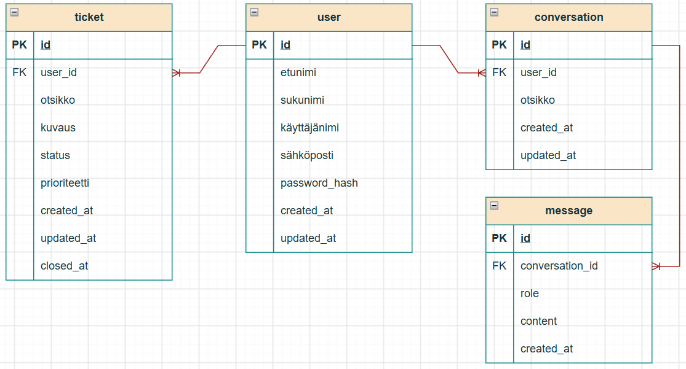

# AI HelpDesk – Järjestelmän suunnittelu

## 1. Johdanto

### 1.1 Dokumentin tarkoitus

Tämä dokumentti kuvaa AI HelpDesk -sovelluksen teknisen suunnittelun. Se määrittelee järjestelmän arkkitehtuurin, tietokannan rakenteen, tietokannan entiteettien väliset suhteet, REST-rajapinnan sekä käyttöliittymän keskeiset näkymät.

Suunnittelun tavoitteena on luoda selkeä ja ylläpidettävä rakenne, joka tukee sovelluksen keskeisiä toimintoja:

- Käyttäjien rekisteröityminen ja kirjautuminen.
- Käyttäjäprofiilin hallinta.
- Tukipyyntöjen luominen ja hallinta.
- Tekoälypohjainen keskustelu.
- Keskusteluviestien pysyvä tallentaminen.
- Tukipyynnön luominen keskustelun perusteella.
- Tietopohjainen tekoälyneuvonta (RAG) tulevana laajennuksena.

### 1.2 Järjestelmän tavoitteet

AI HelpDesk -sovelluksen tavoitteena on tarjota käyttäjälle yksi palvelu, jossa teknisiä ongelmia voidaan ratkaista tekoälyn avulla ja tarvittaessa siirtää ratkaisemattomat ongelmat tukipyyntöjen käsittelyyn.

Järjestelmän tulee olla:

- **Turvallinen:** käyttäjä voi käsitellä vain tietoja, joihin hänellä on oikeus.
- **Ylläpidettävä:** käyttöliittymä, backend, tietokanta ja tekoälyintegraatio ovat selkeästi erotettuja.
- **Laajennettava:** uusia toimintoja voidaan lisätä ilman koko järjestelmän uudelleensuunnittelua.
- **Luotettava:** virhetilanteet käsitellään hallitusti ja käyttäjälle annetaan ymmärrettävä palaute.
- **Testattava:** keskeisille toiminnoille voidaan toteuttaa yksikkö- ja integraatiotestit.

### 1.3 Käyttäjäroolit

| Rooli | Kuvaus |
|---------|---------|
| Rekisteröitynyt käyttäjä | Hallitsee profiiliaan, keskustelee tekoälyn kanssa ja hallitsee omia tukipyyntöjään. |
| Sovelluksen kehittäjä | Toteuttaa, testaa, ylläpitää ja dokumentoi järjestelmää. |

Kehittäjärooli kuvaa projektin teknistä vastuuta eikä automaattisesti tarkoita erillistä sovelluksen ylläpitäjäroolia.

---

## 2. Järjestelmän arkkitehtuuri

### 2.1 Arkkitehtuurin yleiskuvaus

AI HelpDesk toteutetaan kerroksittaisena web-sovelluksena. Frontend vastaa käyttöliittymästä, backend liiketoimintalogiikasta ja tietoturvatarkistuksista sekä tietokanta pysyvästä tallennuksesta. Tekoälypalvelua käytetään teknisten ongelmien analysointiin ja ratkaisuehdotusten tuottamiseen.

Kuvassa RAG-komponentti on suunniteltu laajennus. MVP-versiossa tekoälypalveluun voidaan yhdistää suoraan keskustelupalvelusta ilman dokumentaatiohakua.

### 2.2 Frontend

Frontend tarjoaa käyttäjälle visuaalisen käyttöliittymän ja välittää käyttäjän toiminnot backendille REST-rajapinnan kautta.

#### Frontendin vastuut

- Rekisteröitymis- ja kirjautumisnäkymät.
- Käyttäjäprofiilin tarkastelu ja päivittäminen.
- Tukipyyntöjen luominen, tarkastelu ja sulkeminen.
- Tekoälykeskustelun näyttäminen.
- Keskusteluhistorian näyttäminen.
- Lomakkeiden syötteiden alustava validointi.
- Onnistumis- ja virheilmoitusten näyttäminen.
- Suomen- ja englanninkielisen käyttöliittymän tukeminen.

Frontend ei vastaa käyttöoikeuksien lopullisesta tarkistamisesta. Kaikki suojattujen tietojen käsittelyä koskevat tarkistukset tehdään backendissä.

### 2.3 Backend

Backend tarjoaa REST-rajapinnan ja toteuttaa sovelluksen liiketoimintalogiikan.

#### Backendin vastuut

- Käyttäjien rekisteröityminen ja kirjautuminen.
- Autentikointi ja käyttöoikeuksien tarkistaminen.
- Pyyntöjen validointi.
- Tukipyyntöjen ja keskusteluviestien käsittely.
- Tietojen lukeminen ja tallentaminen tietokantaan.
- Tekoälypalvelun kutsuminen ja vastausten käsittely.
- Virhetilanteiden hallinta.
- Rajapinnan yhtenäisten HTTP-vastausten palauttaminen.

#### Backendin loogiset komponentit

| Komponentti | Vastuu |
|------------|---------|
| Auth Service | Käyttäjän tunnistaminen ja käyttöoikeudet |
| User Service | Profiilitietojen hallinta |
| Ticket Service | Tukipyyntöjen luominen ja päivittäminen |
| Chat Service | Keskustelujen ja viestien käsittely |
| AI Service | Tekoälypalvelun integraatio |
| Knowledge Service | Dokumentaation haku RAG-laajennuksessa |

Nämä ovat loogisia komponentteja, eivät välttämättä erillisiä palvelimia tai mikropalveluita.

### 2.4 Tietokanta

Järjestelmän ensisijaisena relaatiotietokantana käytetään MySQL-tietokantaa.

Tietokanta tallentaa:

- Käyttäjien tiedot.
- Tukipyynnöt ja niiden tilat.
- Keskustelut.
- Keskusteluviestit.
- Tarvittavat luonti- ja päivitysajat.

Tietokannan viite-eheys varmistetaan pää- ja viiteavaimilla. Käyttäjäkohtaisissa hauissa käytetään tunnistetun käyttäjän omistajuuteen perustuvia suodatuksia.

### 2.5 Tekoälyintegraatio

AI Service välittää käyttäjän viestin ulkoiselle tekoälypalvelulle ja käsittelee saadun vastauksen.

#### Tekoälyintegraation tulee

- Käyttää palveluntarjoajan suojattua rajapintaa.
- Säilyttää API-avaimet vain backendin palvelinpuolen konfiguraatiossa.
- Käsitellä aikakatkaisut, palveluvirheet ja käyttörajoitukset.
- Rajoittaa tekoälylle lähetettävän keskustelukontekstin määrää.
- Tallentaa keskusteluviestit sovelluksen määrittelemien tallennuskäytäntöjen mukaisesti.
- Välttää tarpeettomien henkilötietojen lähettämistä ulkoiselle palvelulle.

Tekoälyn tuottamat vastaukset ovat ehdotuksia. Niiden oikeellisuutta ei voida taata kaikissa tilanteissa.

---

## 3. ER-diagrammi

